# МедТермин
## Practical user guide
A complete, nontechnical walkthrough for visitors, patients, doctors, receptionists and company administrators.
Prepared 6 November 2026 • English edition

## 01 | The whole journey at a glance
МедТермин helps people find a clinic or doctor and helps the clinic organise appointments. It connects public browsing, patient accounts and the clinic’s everyday diary.

The usual journey is: browse → choose a doctor and service → inspect available times → sign in or register → review the appointment → submit → follow its status. Looking at a time does not reserve it. A reservation exists only after the final submission succeeds.

A clinic first needs its specialties, doctors, services and working hours set up. Reception can then arrange telephone bookings, help people obtain accounts and keep the diary accurate. Doctors manage their own timetable and appointment outcomes. The company administrator registers clinics and manages their public details.

> Start here: a visitor needs no account to explore public information. A patient account belongs to a particular clinic; it is not a universal pass to every clinic on the website.

This guide describes the current application, reviewed against version 9c83651 on 6 November 2026. The production website may show an older version until it is updated. Screenshots use local demonstration/example data, not real patient records. Labels are shown in Macedonian so they match the default interface; English equivalents are explained throughout.

The guide is about using the product. It does not contain passwords, server settings or instructions for changing databases.

## 02 | Who can do what?
The word “administrator” refers to two different responsibilities. A receptionist/clinic administrator works inside one clinic. A company/platform administrator manages clinic registrations for the organisation operating МедТермин. These are separate accounts and workspaces.

| Person | Main purpose | What the person can see or manage |
| Visitor | Explore before signing in | Public clinics, doctors, services and available times; no patient information. |
| Patient | Manage personal appointments | Their own profile and appointments in their clinic; available doctors and services. |
| Doctor | Organise their own practice | Their own appointments and availability; clinic patient contacts, with appointment history limited to their visits. |
| Receptionist / clinic administrator | Organise the whole clinic | Clinic diary, patients, doctors, specialties, services, reports and user access. |
| Company administrator | Bring clinics onto the platform | Clinic registrations, initial clinic administrators and public clinic information. A company login does not automatically grant a clinical workspace login. |

Doctors can add and edit patient contact profiles and manage their own hours. They cannot edit another doctor’s hours or use clinic account administration. Reception manages the catalogue and login accounts. Patients cannot edit clinic hours, another patient’s appointments or the clinic’s list of services.

> If a menu item is missing, first check your role. A smaller menu is often intentional, not a malfunction.

## 03 | Where to start and how to navigate
Use the address provided by the organisation. The intended entry points are:

| Address | Opens |
| https://medtermin.mk/ | The public landing/search page. |
| https://app.medtermin.mk/ | Clinic sign-in and workspace. |
| https://admin.medtermin.mk/ | The separate company administration area. |

The public header offers **Клиники** (Clinics), **Лекари** (Doctors) and **Најави се** (Sign in). A signed-in clinic user can return through **Мој работен простор**. Clicking the МедТермин brand takes you back to the relevant home entry.

Inside the workspace, the left navigation changes according to role. The highlighted item shows where you are. **Управување** expands to show its available sections; its arrow opens or collapses the group. On a phone, use the menu button at the top left. Scroll the sidebar if an item is below the screen.

Click your name/avatar at the top right for personal settings, password change and sign-out. Theme, language and time-zone details are in that dialog, not in the workspace footer.

The footer on public pages contains site links, CODEX information and social links. External links open another site. Privacy/terms items marked **Наскоро** are placeholders, not completed information pages. Company administration is reached through its separate address, not a public company-access footer link.

## 04 | The full workspace menu
| Label | Patient | Doctor | Reception |
| Преглед — Overview | Personal summary and next visits. | Today’s work and own appointments. | Clinic summary and next appointments. |
| Календар — Calendar | Not in the patient menu. | Own calendar. | Clinic calendar; select a doctor to inspect availability. |
| Термини — Appointments | Own bookings and history. | Appointments with this doctor. | Clinic bookings and filters. |
| Пронајди лекар — Find a doctor | Doctor/service browsing. | Use Управување → Лекари. | Use Управување → Лекари. |
| Мој профил — My profile | Personal contact profile and history. | Not a doctor-account editor. | Open a patient through Пациенти. |
| Управување → Лекари | Not a staff management area. | Doctor list; own availability actions. | Doctor profiles, catalogue settings and availability. |
| Управување → Пациенти | Not available. | Patient contacts and own-visit history. | Patient contacts and clinic appointment history. |
| Управување → Специјалности / Услуги | Not available. | Not available. | Add/edit specialties and services. |
| Извештаи — Reports | Not available. | Not available. | Clinic activity, charts, tables and CSV exports. |
| Сметки и пристап — Accounts and access | Not available. | Not available. | Create logins, reset credentials, enable/disable access. |

**Лекари и клиники** near the bottom of the sidebar returns to public browsing. A **Промени демо-корисник** option or **ДЕМО-РЕЖИМ** label belongs to the training environment. Normal production use is through personal sign-in.

## 05 | Public search: finding the right person or clinic
Open **Лекари** to search doctors and service profiles, or **Клиники** to search clinics. Enter a whole name or part of one. For example, entering “Јован” should find matching public doctor names without requiring you to know the specialty or clinic.

The main doctor-search box also looks across clinic names, specialties and services. Macedonian/Cyrillic text is supported. Search finds listed information; it does not create records or book a visit.

Use **Дополнителни филтри** when you want to narrow the results by clinic, specialty or service. These restrictions work together: a more specific search can legitimately return fewer results. A new main search clears the previous doctor refinements. The clinic tab searches clinics and does not carry over hidden doctor-specific restrictions.

Active filters appear as chips. Remove an individual chip, use **Исчисти сè**, or search all clinics again when you no longer want a clinic restriction. Use the result-page controls when there are more matches.

If nothing appears, shorten the name, check spelling and remove filters. A hidden clinic, inactive provider or unlisted service may not appear publicly; reception can help confirm what is available.

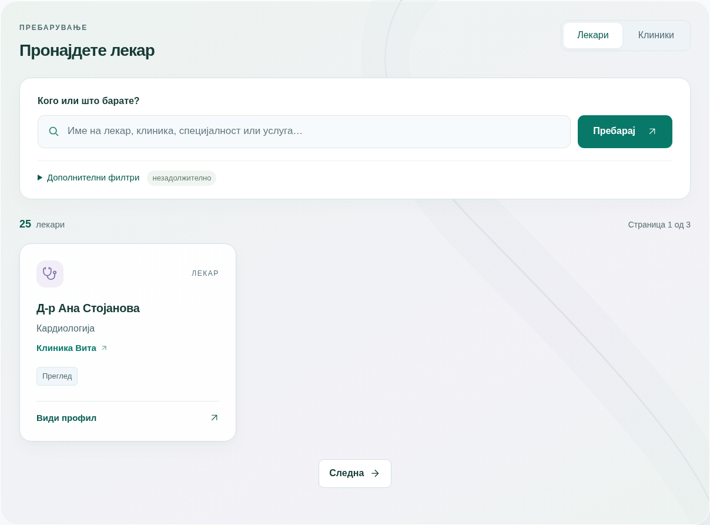

## 06 | Clinic and public doctor pages
A clinic page introduces the clinic and lists its public doctors/services. The information box can show the address and telephone. Use the phone link to call on a supported device, or **Отвори во Maps** for directions.

The embedded map is based on the clinic’s entered address and depends on the external map service loading. No address means no invented location. A map pin is a location aid, not an appointment or a guarantee about directions.

A doctor page shows the name, specialty, clinic and available services. In **Слободни термини**, choose a date, select a service where offered, then use **Прикажи термини**. The nearby date buttons let you inspect the next days quickly.

Click an available time to continue towards booking. **Продолжи кон закажување** offers the same continuation without choosing a specific time first. An unsigned visitor is asked to sign in; the selected doctor and, where selected, date/time/service are carried forward for review. Availability is checked again before saving.

A reception-only doctor directs the visitor to the clinic. A doctor with no published hours or no online services shows an explanatory message. It does not mean that the clinic is closed; a telephone arrangement may be needed.

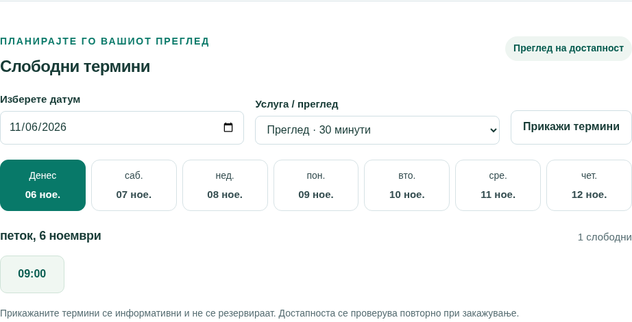

## 07 | Signing in, registering and getting help with access
For an existing account, choose **Најави се**, enter the login email and password, and submit. The email identifies the clinic account. Successful sign-in opens the workspace or returns to the doctor/booking journey you started.

A new patient may choose **Создајте пациентска сметка**. Select the intended clinic if the form requests it, enter the name, email and password, then submit. Public registration creates a patient profile and patient login together. It does not create staff accounts. The clinic must allow new patient registration.

If reception already created your patient profile, ask reception to create/activate the login linked to that profile. Public registration does not automatically attach a new login to an existing profile merely because an email looks the same. Avoid creating duplicate profiles.

Passwords require **12–128 characters**. The eye icon reveals only what you have typed into that password field; it does not reveal a stored password. Check keyboard language and accidental spaces if sign-in fails. Repeated failures can temporarily lock access. There is no email-based “forgot password” flow: contact reception for clinic-account help, or the company support contact for a company account.

Accounts are clinic-specific. A login for one clinic cannot book into a different clinic’s protected workspace. Changing between website hostnames can also require signing in again; keep following the same booking journey where possible.

## 08 | Understanding the overview screen
**Преглед** is the opening workspace summary. It is a practical starting point, not the complete management screen for every record.

A patient sees upcoming visits, pending confirmations, doctor/service browsing and earlier visits. Reception sees today’s clinic activity, upcoming bookings and requests needing attention. A doctor sees the same idea focused on their own work and hours.

Click a next appointment to open its details. Use the prominent booking action or **Пронајди лекар** to find the next visit. The overview’s week display gives a quick picture; use **Календар** or **Термини** for precise date/filter work.

Numbers depend on your role, the current date and current appointment statuses. An overview count is not a financial report or an automatic record that care was delivered.

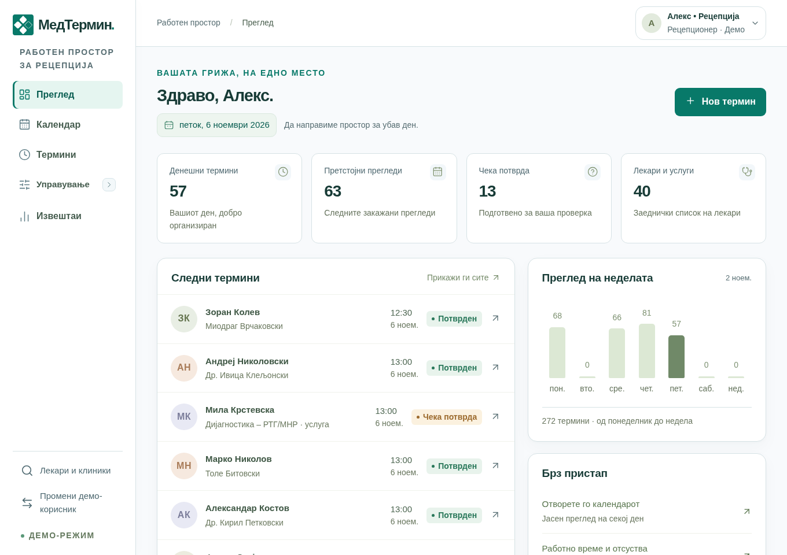

## 09 | Booking: choose the details
Open booking from a doctor’s **Пронајди термин**, a patient’s **Закажи**, the overview’s booking button or a suitable calendar time. The dialog has three stages: **Лекар и термин**, **Проверка**, then the saved result.

1. **Лекар:** select the intended doctor or service profile. You can type to search the dropdown, then choose a real result.
2. **Услуга / преглед:** choose an offered service. Its duration determines how much time the appointment uses. Older profiles may use their default duration without an assigned service.
3. **Изберете датум:** select the date. Normal booking is for future times, up to 180 days ahead.
4. **Пациент:** staff select the patient; a signed-in patient books for themselves. Type to search and select the correct record. Staff can use **+ Додај пациент** if the person is genuinely new.
5. Select an available time. Check the duration and any reception/confirmation note.
6. Click **Провери го терминот**.

> Typing a name is not the same as selecting it. Pick an item from the dropdown results before continuing. The app rejects uncommitted search text rather than silently booking the wrong person.

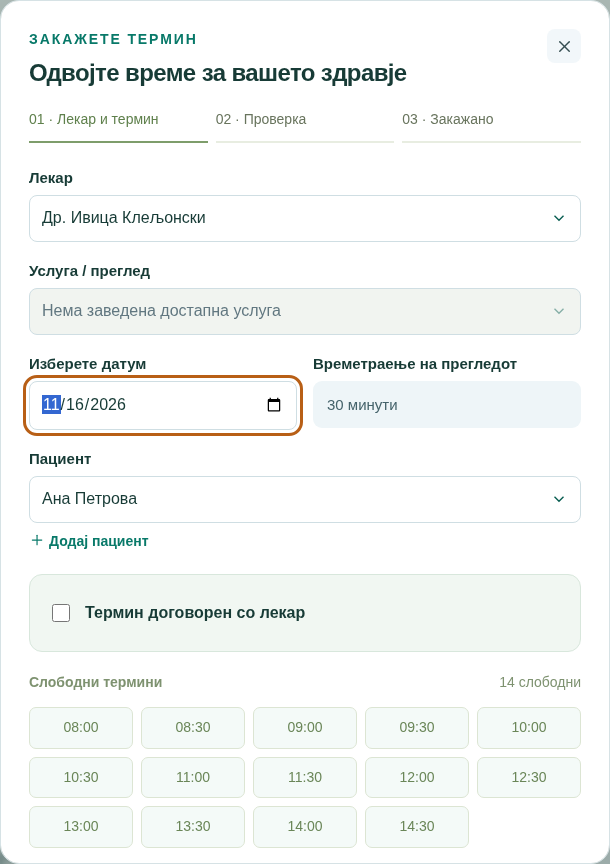

## 10 | Booking: review, submit and read the result
The review stage presents the chosen doctor, patient, service, date, time and duration. Check all of them, especially similarly named patients and doctors. **Назад** returns to the editable selection stage.

The final button saves the appointment. While saving, wait for the result. A successful result shows its status and a booking reference beginning **CL-**. You can open **Види термин** or finish with **Готово**.

A successful save is either immediately confirmed or reserved pending staff confirmation. The doctor’s confirmation setting controls this; reception-agreed bookings are confirmed immediately. A pending request already occupies the selected time.

Seeing a free time earlier does not guarantee that it is still available. If another user takes it first, the app rejects the conflicting save and asks you to choose again. Do not assume the appointment exists if there is no successful result. If the connection fails during submission, refresh/check **Термини** before trying a new booking, because the first submission may have succeeded.

No email, SMS or automatic reminder is sent by the current booking flow. Tell the patient the agreed details or ask them to check their account.

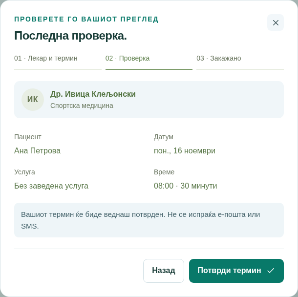

## 11 | The five appointment statuses
| Status on screen | Meaning and how it is assigned | What can happen next |
| Чека потврда — Awaiting confirmation | Booking/rescheduling for a doctor who requires confirmation. The time is reserved. | Staff confirm a future request, or an allowed cancellation releases the time. |
| Потврден — Confirmed | Saved without confirmation required, confirmed by staff, or booked as a reception-agreed time. | May be rescheduled/cancelled while future; after its end staff record the outcome. |
| Завршен — Completed | The visit has ended and an authorised staff member selects the completion action. Reports also call these Реализирани. | Final state. It is not assigned automatically when the clock passes the end. |
| Откажан — Cancelled | An authorised user cancels an eligible appointment and confirms the action. | Final state; the time becomes available again if other availability rules permit it. |
| Не се појавил — No-show | After the appointment’s end, staff record that the patient did not attend. | Final state. It is not automatic. |

Patients cannot confirm requests or mark completed/no-show outcomes. They can cancel their own eligible future appointments. Reception can act across the clinic; doctors act on their own appointments.

If a pending request’s start passes, it cannot be confirmed or rescheduled. Staff can explicitly cancel it; after its end they can instead mark completed or no-show. A confirmed appointment that has already started is resolved as completed/no-show after its end, rather than cancelled through the normal future-booking action.

There is no automatic “expired”, “arrived” or “in progress” status. Final states cannot be reopened through the ordinary interface. Contact an authorised administrator if an outcome was recorded incorrectly.

## 12 | Appointment lists, details, changes and history
Open **Термини** and choose **Претстојни**, **Претходни** or **Сите**. “Previous” is a list grouping, not a sixth appointment status. It can include past requests and cancelled records as well as finished visits.

Search by doctor/patient name and combine the available doctor, patient, service, status and date filters. Patient/doctor accounts receive a restricted view. From/to dates include both selected dates. Use **Исчисти** to remove restrictions.

Open **Детали** to inspect the participants, service, local date/time, duration, booking reference, status and change history. The timeline shows recorded creation, rescheduling and status changes, with who made them and when. Older appointments may predate detailed history; missing older entries are not reconstructed.

To move an eligible future visit, use **Презакажи**. The dialog starts on the original date and keeps the original doctor, patient, service and duration. Choose a new free time, review and submit. A doctor requiring confirmation causes the moved visit to await confirmation again. A failed move preserves the original reservation.

To cancel, use **Откажи преглед** and read the confirmation dialog. **Задржи ја тековната состојба** backs out; the confirm button performs the change. A cancelled appointment remains visible in history. Cancellation does not delete the patient or account.

## 13 | A patient’s everyday workflow
1. Sign in to the intended clinic and check **Преглед** for the next visit and any pending confirmation.
2. Use **Пронајди лекар** to compare doctors, services and working schedules. **Види профил** explains the provider; **Пронајди термин** opens booking. For reception-only providers, contact the clinic.
3. Book a suitable available time and check the final status. Awaiting confirmation is not yet a confirmed visit.
4. Open **Термини** to follow upcoming bookings, cancel or reschedule when allowed, and review older visits.
5. Open **Мој профил** for contact details, appointment counts and personal appointment history. Use filters to find a visit.
6. Ask reception to correct contact details or solve access problems. Patients do not edit the clinic contact record themselves through this profile screen.

The default self-service limits are **three future active appointments** and **one pending request per doctor per day**. These are clinic/server settings and may differ. Staff-created future visits count towards the patient’s total. For a legitimate additional visit, ask reception; do not create another account to bypass the limit.

You cannot book two overlapping appointments for yourself, even with different doctors. You cannot use this account to view or book for another patient. Names, services and contact information entered by the clinic remain in their original language when you switch the interface to English.

## 14 | A receptionist’s everyday workflow
Reception has the clinic-wide view. Start with **Преглед**, then open **Календар** or **Термини** to check today’s work and unresolved requests.

For a telephone booking, search the existing patient first. Check name and contact details before creating another profile. Select the doctor/service, find a suitable date/time, review and save. Read back the final status to the caller; the current system does not send the message for you.

Use **Управување → Пациенти** for contact corrections and appointment history. Use **Управување → Лекари** for provider information, booking and access to hours. Only clinic administrators manage specialties, services and login accounts.

Handle confirmation requests before their start times. After visits finish, record completed/no-show outcomes. Resolve overdue pending requests explicitly rather than leaving an inaccurate queue. Reschedule or cancel an existing booking before trying to close hours that overlap it.

Reception may authorise legitimate bookings beyond patient self-service limits, but cannot double-book a doctor or patient or bypass a blocked absence. For a doctor-approved one-off time outside normal hours, use the specific agreed-time workflow in chapter 20.

At handover, explain unresolved pending requests, telephone arrangements and any rejected changes. Use personal logins so the history identifies the responsible person. Sign out through the top-right account dialog when finished.

## 15 | A doctor’s everyday workflow
A doctor account must be linked to that doctor’s existing profile. It is not a general clinic administrator login.

Use **Преглед**, **Календар** and **Термини** to review your own appointments. Open a visit for the patient’s details, confirmation action, history and available outcome buttons. Confirm upcoming requests when appropriate; after the visit ends, mark **Завршен** or **Не се појавил**.

Under **Управување → Лекари**, use the three-dot actions to reach your own **Достапност**. Manage your weekly hours, breaks, leave and additional availability. Changes that would invalidate an already booked visit are rejected. You cannot change another doctor’s schedule.

Use **Пациенти** to find clinic patient contacts, add a contact profile or correct contact details. When you open a patient’s history, your account sees the visits with you, not another doctor’s whole appointment history. This is a scheduling/contact profile, not an electronic medical record.

You can arrange normal bookings for your own practice within the offered availability. The special **Термин договорен со лекар** override is a receptionist/administrator action. Ask reception to use it when a caller has been given a specific one-off time.

You do not have the clinic’s Reports, Accounts and access, specialty/service editing or other doctors’ availability permissions merely because your role is Doctor.

## 16 | The staff calendar
**Календар** is available to doctors and reception. Reception can filter the doctor, specialty, service and status; the doctor’s calendar is restricted to their own practice. Select a specific doctor to display available time and absences alongside bookings.

Use **Ден**, **Недела**, **Месец** or **Период**. Custom **Период** accepts 1–31 days. Previous/next controls move the displayed period; **Денес** returns towards today. Weeks start on Monday. On phones, a day view is usually easier to read; larger views may scroll inside the calendar.

Click a booked item to open its details. Click suitable empty/available time or **Нов термин** to begin booking. Green availability is a guide, not a saved reservation. The final booking rules still apply.

On supported desktop interaction, drag an eligible future appointment to propose a new time. Read the confirmation. If the move conflicts or fails, the item returns to its original position. Dragging does not change the appointment’s duration.

**Освежи** updates the diary. The availability legend explains the colours; read the textual status too. Expand **Работно време и информации за избраниот лекар** for the selected doctor’s schedule and the availability-management action.

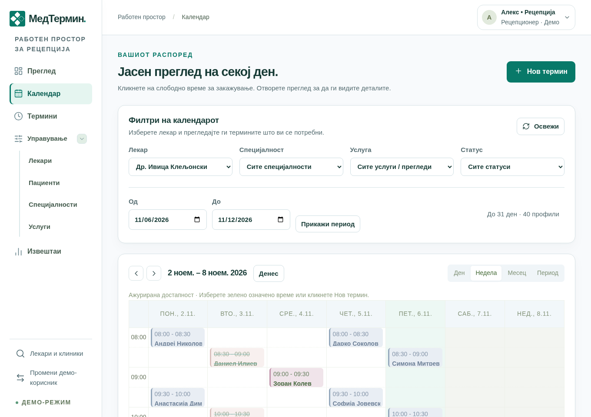

## 17 | Doctor cards, list view and doctor settings
Open **Управување → Лекари**. Search by name or specialty, select a specialty filter, and choose **Листа** or **Картички**. The view preference is remembered in that browser.

**Види профил** shows specialty, booking method, services and weekly hours. **Пронајди термин** starts booking; an information-only action appears where the patient must use reception. A badge indicates fixed hours, booking by arrangement or inactive status.

For staff, the **three-dot menu** contains **Достапност** and, for reception/administrators, **Измени**. Doctors use availability for their own profile. These administrative actions are separate from the two main booking/profile buttons.

Reception can add or edit a doctor’s name, specialty, optional subspecialty, active state, confirmation requirement and reception-only booking policy. **Потребна е потврда за закажување** controls whether normal new/moved appointments await staff approval. Reception-only controls who can book, not whether a booking is automatically confirmed.

A new doctor needs working hours and service assignments before meaningful online booking is available. Inactivating a doctor prevents new bookings; it does not remove old appointments or delete a login account. Imported service-only profiles may appear among providers but cannot be linked to human doctor login accounts.

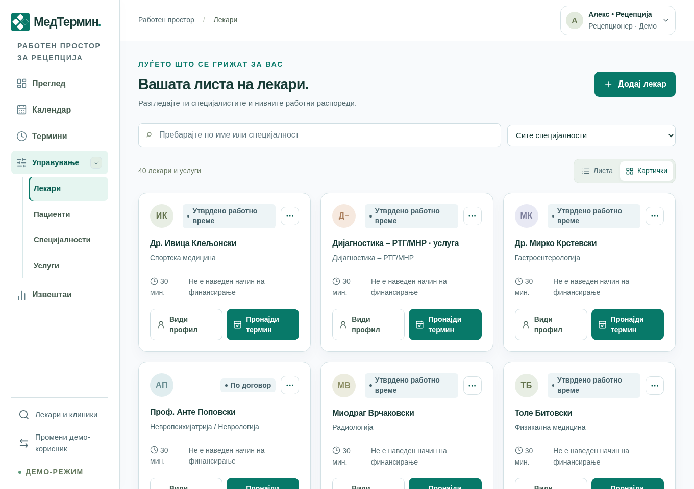

## 18 | Weekly working hours
Open the doctor’s **Достапност** from the three-dot menu or calendar context. The weekly-hours area defines the normal recurring timetable.

Use **Додај работен период** for each shift. Choose the weekday, start and end. Split shifts use separate rows: for example Monday 09:00–12:00 and 14:00–17:00. Use the remove button to remove a row, then **Зачувај работно време** to save the complete displayed schedule.

The duration field accepts 10–120 minutes in five-minute steps. Active services can have their own durations, which determine their booking slots. Existing appointments keep their saved duration. Each working period must have start before end and allow a complete appointment; periods on the same day cannot overlap.

Slots are generated from the saved timetable, minus bookings and blocked absences. Simply adding a doctor or rearranging rows does not invent hours. Days are presented in ordinary Monday-to-Sunday order; notes from an imported document do not tell the app to fill one weekday before another.

If another staff member changed the schedule while you were editing, saving is rejected with a conflict notice. Copy any useful draft notes, load the current hours using the offered action, compare and re-enter the intended change. Do not repeatedly submit the old form.

## 19 | Exceptions, absences and extra availability
Weekly hours repeat. **Исклучоци и отсуства** apply to a specific date: holidays, breaks, leave or a one-off extra working period.

1. Select **Датум**.
2. Choose **Недостапно / пауза** to block time, or **Дополнителна достапност** to add a one-off available period.
3. Enter **Од**, **До** and a short **Причина** such as “Lunch break”. Avoid medical details in this field.
4. Click **Додај исклучок** and wait for success.
5. Review **Зачувани исклучоци**. Its remove button deletes that exception, with confirmation where shown.

For a full-day block, the form advises 00:00–23:59. New bookings are normally within the 180-day window. A break prevents booking even inside normal working hours. Extra availability can supply time on a normally non-working day.

Repeatedly clicking does not intentionally create duplicate identical exceptions; an identical saved item is rejected. A change that would make an existing future booking invalid is also rejected. Arrange that patient’s move/cancellation first. Removing an extra period cannot strand a booking that depends on it.

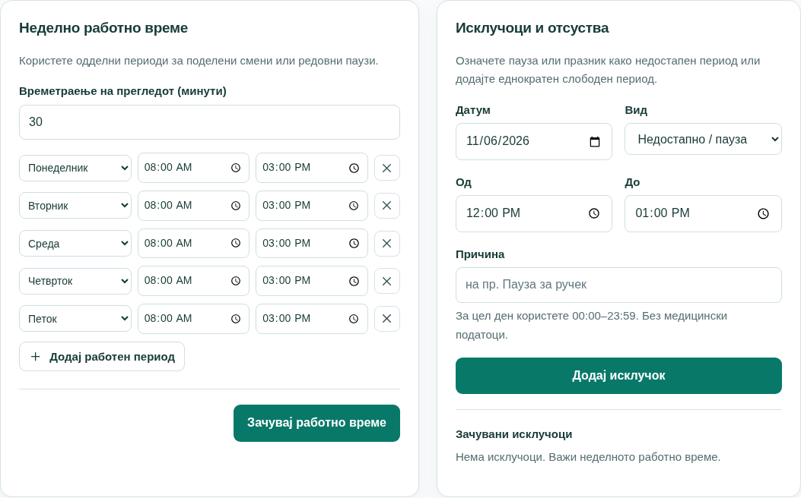

## 20 | A time agreed directly with the doctor
This is the telephone-arrangement case: a doctor has no regular hours, but reception has asked and the doctor has approved a particular time.

Reception/clinic administrators can open normal booking, select the doctor, service, date and patient, and enable **Термин договорен со лекар**. Enter the approved **Договорено време**, review and save.

The system records the one-off availability needed for this appointment together with the booking. It does not change the doctor’s weekly hours or open a whole extra day for everyone. The resulting appointment is **Потврден** immediately because the time has already been agreed.

This is not a way to ignore a conflicting booking, a patient’s other visit or a blocked absence. Those protections still apply. The time must be future, within the booking window, start on a whole minute and finish on the same day. A service/duration that fits is still required where the doctor has assigned services.

A patient or doctor account cannot use this reception-only action. Agree with the doctor first; the checkbox itself does not call the doctor or obtain approval.

If the agreed appointment is cancelled, its attached one-off availability is removed. If it is moved to a different time through ordinary rescheduling, the new time must come from valid availability and the confirmation policy is checked again.

## 21 | Patient directory and patient contact profiles
**Управување → Пациенти** provides the clinic’s contact directory. Search by name, email or telephone. Use **Листа** or **Картички**, **Види профил** for details and **Закажи** to start a booking for the selected person.

**Додај пациент** creates a contact profile, not login credentials. Enter the name; email and telephone can be left blank where the form permits. Use a real, distinct record for each person and search first to avoid duplicates. The same nonblank contact email cannot be reused for another patient in that clinic.

Inside the profile, staff can use **Уреди податоци** to correct name, contact email and telephone. These changes do not change the login email, password or account display name. A patient asks staff for corrections. Other staff may already have edited the record; load the current version if saving is rejected.

The profile shows upcoming, completed, cancelled and no-show counts and an appointment-history table. Filter by period, status, doctor, service or dates, clear filters, and open a visit’s details. Reception sees clinic history; a doctor sees that patient’s visits with them; a patient sees their own permitted history.

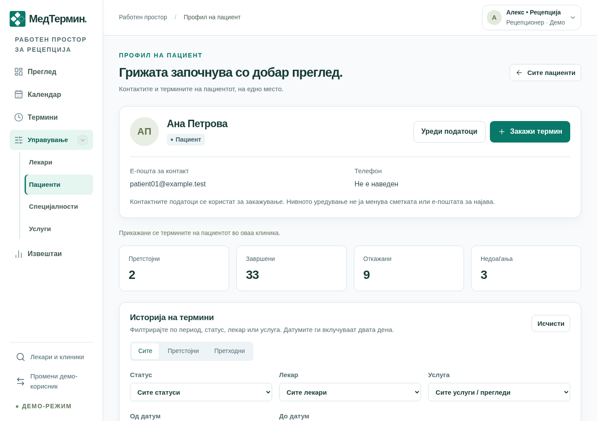

## 22 | Specialties and services
Only reception/clinic administrators edit these sections under **Управување**. They use a simple list; there is no card-view selector for these records.

**Специјалности** organises providers by field, such as cardiology. Search, add a record through **Додај запис**, enter its name and save. **Измени** changes an existing specialty. Renaming a linked specialty updates how its doctors are described. Duplicate names are rejected.

**Услуги** describes what can be booked. Add/edit the service name, specialty, duration, active state and the doctors/profiles that provide it. Duration is 10–120 minutes in five-minute steps. A doctor can provide several services, and one service can be assigned to several appropriate providers.

A service appears for new booking only when it is active and assigned to the selected provider. A missing assignment, inactive service or inactive doctor can explain an empty selection or missing slots. Configure the provider’s hours as well; a service does not create a schedule.

Retiring a service stops new use without erasing older appointment details. Changes to service duration affect new bookings; an existing appointment keeps its recorded duration. Service-only imported providers are appointment resources, not a person who should receive a doctor login.

A helpful setup order is: create specialty → create doctor/profile → create/assign services → enter hours → create staff accounts → verify availability.

## 23 | Creating login accounts for patients and staff
Open **Сметки и пристап** as a clinic administrator. The screen title is **Корисници и пристап**. This creates permission to sign in; it is separate from adding a patient or doctor contact/profile.

| Role in the form | Required linked profile | Typical use |
| Пациент | An existing patient profile. | Give a telephone-booked patient online access to their own visits. |
| Лекар | An existing human doctor profile. | Let that doctor manage their own diary and outcomes. |
| Администратор | No patient or doctor profile. | Give another authorised receptionist clinic-management access. |

Enter **Прикажано име**, **Е-пошта за најава**, role and initial password. Only the applicable profile selector is shown. Choose the intended unlinked person, then use **Создај сметка**. The password needs 12–128 characters.

Each patient/doctor profile can have one linked account. Profiles already linked to accounts are omitted, including profiles whose account is disabled. Service-only providers are omitted from the doctor-login choice. An email already reserved by another clinic account cannot be reused.

No email invitation is sent. Share the initial credentials privately with the intended person and ask them to change the password. If the person already self-registered, check existing accounts before creating another profile or login.

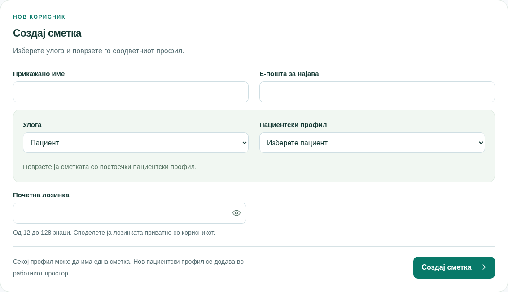

## 24 | Existing accounts, password help and access control
Under **Постоечки сметки**, each account shows its name, email, role and enabled/disabled state. An account is a login; disabling it is not the same as cancelling its appointments or deleting the patient/doctor profile.

Use **Оневозможи пристап** to block access. Existing sessions are signed out. **Овозможи пристап** permits sign-in again; previous sessions do not silently return. The system does not allow you to disable your own account or leave the clinic without an active administrator.

Expand **Постави податоци за најава** to set the account’s login email and a new password, then save. Use this to help a patient who forgot their password. Saving revokes that account’s existing sessions and clears a password lockout. No email is sent; hand over the new details securely.

Editing a patient’s contact email does not perform this change. Likewise, changing login credentials does not rewrite the patient’s contact record. Existing-account controls do not provide a general role/profile reassignment screen; resolve a wrong account link with the authorised administrator instead of altering unrelated patient details.

Never give a shared reception password to a doctor or patient. Use the smallest appropriate role, separate staff accounts and the patient’s own linked profile. The eye icon in a password field shows the newly typed value only.

## 25 | Reports, charts and CSV export
**Извештаи** is for clinic administrators. Choose a from/to period, optionally narrow doctor, specialty or service, and use **Прикажи извештај**. Presets cover today, this week and this month. Group the time results by day, week or month; weeks start on Monday. The maximum range is 366 days.

The tiles summarise all appointments, confirmed, completed, pending, cancelled, no-shows, distinct patients and approximate utilisation. Total includes cancelled appointments. Counts use appointments starting within the selected local dates and their current status, not the date a status button was clicked.

Cancellation rate = cancelled / all appointments. No-show rate = no-shows / (completed + no-shows). A dash indicates a metric with no meaningful denominator. “Patients in period” is distinct people in the filtered visits, including cancelled bookings; the total registered-patient figure is a separate clinic count.

The chart shows volume over time. Table tabs group by period, doctor/profile, specialty or service. **Преземи CSV** downloads the currently selected table with its filter information for spreadsheet use.

Utilisation estimates booked non-cancelled minutes against capacity from current hours and saved exceptions. It is not a historical staffing record. Capacity is shared by services, so do not add every service’s capacity together. These reports describe scheduling activity, not payments or clinical quality.

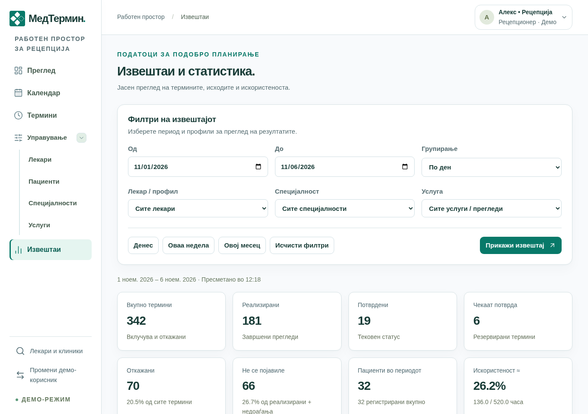

## 26 | Company administration: registering a clinic
The company administrator signs in through the company portal, normally **admin.medtermin.mk**. Clinic login credentials do not grant access here. There is deliberately no company-access link in the public footer.

**Регистрирани клиники** lists registrations and readiness. **Додај нова клиника** creates a clinic and its first clinic administrator.

| Field | What to enter |
| Единствен идентификатор | A unique short ID: 1–40 lowercase Latin letters, numbers or hyphens; start with a letter/number. It cannot be changed afterwards. |
| Име на клиниката | The public clinic name, 2–100 characters. |
| Јавен опис / адреса / телефон | Optional public information; description up to 1,000 characters, address 200, telephone 30. Include street, number, city and country for a useful map. |
| Public-search option | Whether the clinic appears to public visitors. |
| Patient-registration option | Whether new patients may self-register. |
| Initial administrator | Name, login email and a private 12–128-character initial password. This is a clinic account, not the company account. |

Submit **Создај клиника и администратор** once and wait. A preparing state means work is still underway; a failed/needs-retry state requires review, not repeated random submissions. When ready, hand over the initial administrator’s credentials securely. No invitation email is sent.

New clinics start without a populated diary. Their administrator must set up doctors, specialties, services and hours and create other accounts. Clinics keep separate patient/appointment information even though one product serves them.

## 27 | Company administration: maintaining a clinic
For a ready managed clinic, select **Измени податоци**. Edit its public name, description, address, phone and the public-search and new-registration options, then **Зачувај податоци**.

These are different switches. Hiding public search stops the public listing; it does not delete the clinic’s records or automatically revoke its users. Disabling new patient registration prevents new self-service sign-ups; existing accounts and appointments remain.

The identifier stays fixed. Time-zone changes are not offered as ordinary clinic edits because existing appointments depend on the recorded time. Use the established clinic time zone and involve support for an intentional change.

An older clinic may be labelled **Конфигурација** with **Управувај преку платформата**. That is a one-time handover into normal company management. It preserves the clinic’s existing patients, users and appointments; do not register a second replacement clinic just to edit its address. Once handed over, public details are edited through this screen.

If another company user changed the details first, your save is rejected. The reload/discard action loads their latest values; it does not merge your unsaved text automatically.

The company page also has its own sign-out and company-password-change controls. Changing that password signs out its active sessions. These are separate from clinic password management.

## 28 | Personal settings, language, theme and phones
In the workspace, click your **name/avatar at the top right**. The account dialog shows who is signed in, their role, the clinic where available, and these controls:

- **Изглед:** choose Standard, Dark or Vibrant. The colours change immediately and the choice is remembered in that browser/site. It does not change clinic data or discard a form behind the dialog.
- **Јазик:** flag buttons MK and EN switch Macedonian/English. Macedonian is the first-visit default. Switching reloads the page while keeping its location; a warning protects unsaved form input. Clinic-entered names and records are not translated.
- **Временска зона:** information about how clinic times are presented, normally Europe/Skopje. This is not a user-editable appointment-time setting.
- **Промени лозинка:** enter current/new password; saving signs out active sessions. This action is available for normal accounts, not the password-free training demo.
- **Одјави се:** end access from this browser. Do this on a shared device.

Close with X, Escape or a click outside. Tab stays within the open dialog. On a small phone, scroll inside it if necessary. It respects reduced-motion preferences and is hidden when printing. Public/login/company pages keep their language/theme selectors at the bottom.

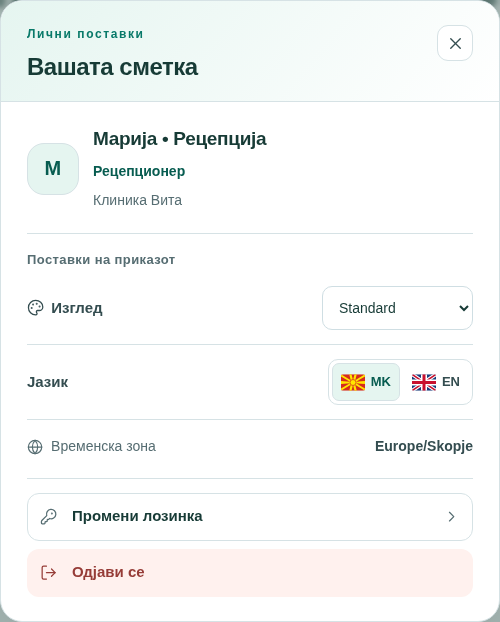

## 29 | What happens when two people work at once?
Several receptionists can work in the same clinic. The app checks again when a change is saved, because another person may have changed the same appointment or timetable after you opened it.

| Situation | What happens | What to do |
| Two people choose the same doctor/time | Only an eligible non-overlapping booking can be saved. | Read the conflict, refresh availability and choose another time. |
| A patient already has a visit with another doctor | An overlapping booking is rejected. | Find a time that works for both the doctor and patient. |
| A colleague changes a timetable, contact record or appointment first | Your stale save is rejected rather than silently replacing their change. | Read the current values, compare and re-enter the intended change. |
| A request times out | It may have been saved before the response was lost. | Check the list/history before making a new booking. |

Background information refreshes during normal use, but that is not permission to overwrite an old form. Open dialogs pause ordinary workspace polling. A schedule draft keeps its original saved context until you submit or deliberately load newer data.

Idempotent submission protects a retry of the same booking request, but it is not a substitute for checking the result. Avoid repeated clicking. A rejected move keeps the original booking; a cancellation must be explicitly confirmed. These rules protect the diary, not guarantee that your preferred time remains available forever.

## 30 | Four real-world walkthroughs
**A. A visitor finds a doctor.** A visitor searches “кардиологија”, opens the doctor’s profile, chooses a service/day and clicks a time. They sign in or create an eligible new patient account, review the carried-forward details and submit. They then read whether the visit is confirmed or pending. The public slot alone was never a reservation.

**B. A patient telephones reception.** Reception searches the patient directory, verifies the right person and contact number, opens **Закажи**, chooses the doctor/service and saves an available time. If the caller wants online access, reception creates a Patient account linked to that existing profile and shares its initial credentials privately. There is no need to create a second patient profile.

**C. A doctor has agreed to 14:00 on a day without regular hours.** Reception verifies the agreement, uses **Термин договорен со лекар**, enters the time and submits. It saves only if there is no doctor/patient overlap or blocked absence. The weekly timetable stays the same and the appointment is confirmed. The system does not contact the doctor itself.

**D. A doctor must take unexpected leave.** Staff first identify future bookings in the affected period and contact the patients to arrange permitted moves/cancellations. Then the authorised user adds the dated absence. If a protected booking still conflicts, the absence is rejected. Adding leave does not automatically notify or move patients.

> Practice using training/example data first. Do not change real appointments merely to explore buttons.

## 31 | Common problems and plain-language answers
| Question or message | What to check next |
| No matching doctor/patient | Shorten the search, check Cyrillic spelling, clear filters and verify you are in the intended clinic. |
| No free appointments | Check another date/service; hours, absences, existing bookings or reception-only policy may explain it. |
| Typed a name but cannot continue | Select an actual dropdown result, not just the typed text. |
| Cannot choose a patient/doctor when making an account | The profile may already have a login. Doctor logins require a human profile, not a service-only resource. |
| Cannot self-register | Registration may be disabled, the email already used, or a patient profile may already exist. Ask reception. |
| Forgot password / account unavailable | Use the eye icon to check typed text; ask the authorised administrator for credential/access help. No email reset is available. |
| Cannot mark completed/no-show | Wait until the visit’s end; use an authorised staff account and the correct appointment. |
| Pending visit is already past | Staff resolve it explicitly; patients should contact reception. It does not auto-expire. |
| “Changed in another session/window” | Load the current record; do not keep submitting the old version. |
| Map or external link does not load | Check the entered address and connection; use Open in Maps or call the clinic. |
| Session expired / access denied | Sign in again with the correct role/clinic. Do not work around it by sharing another person’s login. |
| A data service is unavailable | Keep the current result uncertain, retry/refresh when appropriate and contact support; do not assume a save failed or succeeded. |

## 32 | Quick reference, limits and boundaries
| Term | Meaning |
| Clinic | The organisation whose users, patients and diary you are working with. |
| Patient profile | The patient’s contact record and linked appointment history. It may exist without a login. |
| Account | Email/password and permissions used to sign in. |
| Doctor/profile | A provider in the diary; some imported profiles represent a service resource rather than a person. |
| Specialty / service | Specialty is the field; service is the bookable offering and its duration. |
| Availability exception | A dated change to normal hours, either blocked or additionally available. |
| Booking reference | The CL- reference for identifying an appointment; it is not a password or payment receipt. |
| CSV | A spreadsheet-readable export of the chosen report table. |

**Practical limits:** normal future booking up to 180 days; calendar custom range 1–31 days; reports up to 366 days; appointment/service durations 10–120 minutes in five-minute increments; passwords 12–128 characters. Patient self-service defaults to three future active visits and one pending request per doctor/day; the operator can configure those two limits.

**Not provided by the current product:** automatic email/SMS confirmations or reminders, email password recovery, automatic past-visit completion/no-show/expiry, online payments, diagnosis/treatment records, document uploads or one universal patient login across all clinics. Do not assume a booked appointment verifies someone’s identity or that the contact profile is a medical chart.

**Before your first working day:** confirm your clinic/role, set a private password, inspect the real hours/services, practise the booking review and cancellation confirmation, and learn whom to contact for access or diary problems. At handover, check pending requests and unrecorded outcomes; sign out when finished.

For a new clinic: register clinic and administrator → configure specialties, doctors and services → assign hours → create required accounts → verify public details and booking → begin ordinary use.
