# МедТермин
## Прирачник за користење
Целосно и разбирливо објаснување за посетители, пациенти, лекари, рецепционери и компаниски администратори.
Подготвено на 6 ноември 2026 • Македонско издание

## 01 | Целиот тек на едно место
МедТермин им помага на луѓето да пронајдат клиника или лекар, а на клиниката — да ги организира термините. Јавното пребарување, пациентските сметки и секојдневниот распоред се поврзани во една целина.

Вообичаениот тек е: пребарување → избор на лекар и услуга → проверка на слободни термини → најава или регистрација → проверка на избраните податоци → зачувување → следење на статусот. Самото разгледување или кликнување на слободен час не го резервира терминот. Резервацијата постои дури по успешно завршување на последниот чекор.

Клиниката најпрво треба да ги уреди специјалностите, лекарите, услугите и работното време. Потоа рецепцијата може да закажува по телефон, да помага со кориснички сметки и да го одржува распоредот. Лекарите ги управуваат сопствените часови и исходите од прегледите. Компанискиот администратор регистрира клиники и ги уредува нивните јавни податоци.

> За почеток: посетителот може да разгледува јавни информации без сметка. Пациентската сметка припаѓа на конкретна клиника; таа не е единствен пристап до сите клиники на веб-страницата.

Прирачникот ја опишува тековната верзија, проверена според изданието 9c83651 на 6 ноември 2026. Официјалната веб-страница може да прикажува постаро издание додека не биде ажурирана. Сликите се од локално демонстративно опкружување со примерни податоци, а не од вистински пациентски досиеја.

Ова е прирачник за користење. Не содржи лозинки, серверски поставки или упатства за менување бази на податоци.

## 02 | Кој што може да прави?
Зборот „администратор“ има две различни значења. Рецепционерот/администраторот на клиниката работи во една клиника. Компанискиот администратор ја претставува организацијата што управува со МедТермин и ги регистрира клиниките. За нив се користат одделни сметки и работни простори.

| Корисник | Главна цел | Што гледа или управува |
| Посетител | Разгледување пред најава | Јавни клиники, лекари, услуги и слободни термини; нема пристап до пациентски податоци. |
| Пациент | Лични закажувања | Сопствен профил и термини во својата клиника, како и достапни лекари и услуги. |
| Лекар | Сопствена работа | Сопствени термини и достапност; контактите на пациентите во клиниката, со историја ограничена на прегледите кај тој лекар. |
| Рецепционер / администратор на клиника | Организација на клиниката | Распоред, пациенти, лекари, специјалности, услуги, извештаи и кориснички пристап. |
| Компаниски администратор | Регистрација и претставување на клиники | Регистрации, прв администратор и јавни податоци за клиниката. Компаниска најава не значи автоматски пристап до клинички работен простор. |

Лекарите можат да додаваат и уредуваат пациентски контактни профили и сопственото работно време. Не можат да го менуваат распоредот на друг лекар или да ги управуваат сметките. Рецепцијата ги уредува услугите, специјалностите и најавите. Пациентот не може да менува туѓ термин, работно време или клинички услуги.

> Ако некоја ставка не се прикажува, прво проверете ја вашата улога. Пократкото мени често е намерно ограничување, а не грешка.

## 03 | Од каде да почнете и како се движите
Користете ја адресата што ви ја дала организацијата. Предвидените почетни адреси се:

| Адреса | Што отвора |
| https://medtermin.mk/ | Јавната почетна страница и пребарувањето. |
| https://app.medtermin.mk/ | Најава и работен простор на клиниката. |
| https://admin.medtermin.mk/ | Одделниот дел за компаниска администрација. |

Во јавната горна навигација се **Клиники**, **Лекари** и **Најави се**. Најавен корисник на клиника може да се врати преку **Мој работен простор**. Логото МедТермин води кон соодветната почетна страница.

Во работниот простор, левото мени се менува според улогата. Означената ставка покажува каде сте. **Управување** ги отвора достапните потставки; стрелката ја проширува или собира групата. На телефон, менито се отвора со копчето горе лево. Ако е потребно, лизгајте низ страничното мени.

За лични поставки, промена на лозинка и одјава, кликнете на вашето име/аватар горе десно. Изгледот, јазикот и временската зона се во тој прозорец, а не во долниот дел на работниот простор.

На јавните страници, долниот дел содржи навигација, информации за CODEX и врски кон социјални мрежи. Надворешните врски отвораат друга веб-страница. Ставките за приватност и услови означени со **Наскоро** сè уште не се завршени информативни страници. Компаниската администрација се отвора преку нејзината адреса, без јавна врска „Пристап за компанијата“ во подножјето.

## 04 | Целото мени во работниот простор
| Ставка | Пациент | Лекар | Рецепција |
| Преглед | Лично резиме и следни прегледи. | Денешна работа и сопствени термини. | Резиме на клиниката и следни термини. |
| Календар | Не се прикажува. | Сопствен календар. | Календар на клиниката; избор на лекар за достапност. |
| Термини | Сопствени закажувања и историја. | Термини кај овој лекар. | Термини на клиниката со филтри. |
| Пронајди лекар | Разгледување лекари и услуги. | Преку Управување → Лекари. | Преку Управување → Лекари. |
| Мој профил | Лични контакти и историја. | Не е уредувач на лекарска сметка. | Пациентот се отвора преку Пациенти. |
| Управување → Лекари | Нема управувачки дел. | Листа на лекари и сопствена достапност. | Профили, поставки и работно време. |
| Управување → Пациенти | Не се прикажува. | Контакти и историја на прегледите кај овој лекар. | Контакти и историја во клиниката. |
| Управување → Специјалности / Услуги | Не се прикажува. | Не се прикажува. | Додавање и уредување. |
| Извештаи | Не се прикажува. | Не се прикажува. | Активност на клиниката, графикони, табели и CSV. |
| Сметки и пристап | Не се прикажува. | Не се прикажува. | Креирање најави, нови лозинки и овозможување/оневозможување пристап. |

**Лекари и клиники** при дното на менито води кон јавното пребарување. **Промени демо-корисник** и **ДЕМО-РЕЖИМ** се дел од опкружувањето за обука. Во редовната употреба се најавувате со лична сметка.

## 05 | Јавно пребарување: лекар или клиника
Отворете **Лекари** за пребарување лекари и услужни профили, или **Клиники** за пребарување клиники. Внесете цело име или само дел од него. На пример, „Јован“ треба да ги пронајде соодветните јавно објавени лекари без однапред да знаете во која клиника или специјалност работат.

Главното поле за лекари пребарува и по називи на клиники, специјалности и услуги. Поддржани се македонски и кирилични внесови. Пребарувањето прикажува постоечки информации; не додава записи и не закажува термин.

**Дополнителни филтри** служат за ограничување по клиника, специјалност или услуга. Филтрите се комбинираат, па поспецифичен избор може да даде помалку резултати. Ново главно пребарување ги отстранува претходните дополнителни ограничувања за лекари. Во делот Клиники не се задржуваат скриени лекарски филтри.

Активните филтри се прикажани како ознаки. Отстранете една ознака, изберете **Исчисти сè**, или повторно пребарајте низ сите клиники ако веќе не сакате ограничување на една клиника. Кога има повеќе резултати, користете ги копчињата за следна/претходна страница.

Ако нема резултати, скратете го името, проверете го правописот и тргнете ги филтрите. Скриена клиника, неактивен лекар или необјавена услуга може да не се појавува јавно; рецепцијата може да ја потврди достапноста.

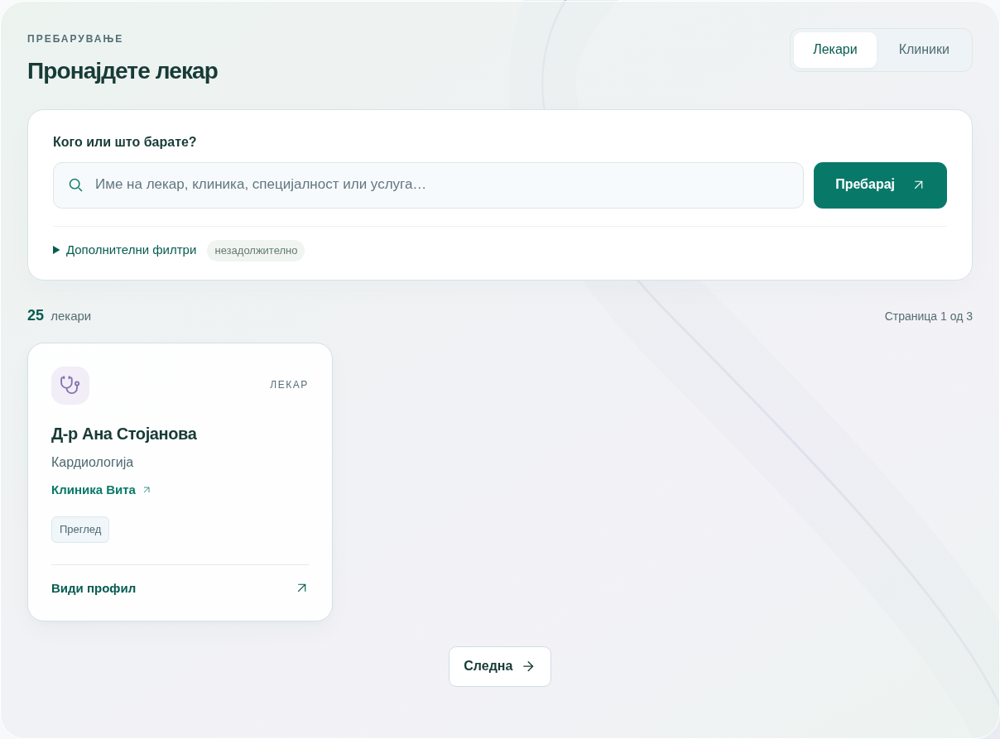

## 06 | Страници за клиника и лекар
Страницата за клиника ја претставува клиниката и ги прикажува нејзините јавни лекари/услуги. Информативната картичка може да содржи адреса и телефон. Телефонската врска може да започне повик на поддржан уред, а **Отвори во Maps** води до насоки за движење.

Мапата се заснова на внесената адреса и зависи од вчитувањето на надворешниот сервис. Ако нема адреса, не се прикажува измислена локација. Ознаката на мапа помага за ориентација; не претставува закажан термин или гаранција за точност на насоките.

Страницата на лекар го покажува името, специјалноста, клиниката и понудените услуги. Во **Слободни термини**, изберете датум и услуга кога е понудена, па **Прикажи термини**. Копчињата со соседни датуми овозможуваат брза проверка на следните денови.

Кликнете на слободен час за да продолжите кон закажување. **Продолжи кон закажување** го започнува истиот тек и без претходен избор на конкретен час. Ненајавен посетител се упатува на најава; избраниот лекар и, кога се избрани, датумот, часот и услугата се пренесуваат за проверка. Достапноста повторно се проверува при зачувување.

За лекар што работи само преку рецепција се прикажува соодветна порака. Лекар без објавени часови или без онлајн услуги исто така има објаснување. Тоа не значи дека клиниката е затворена; можеби е потребен телефонски договор.

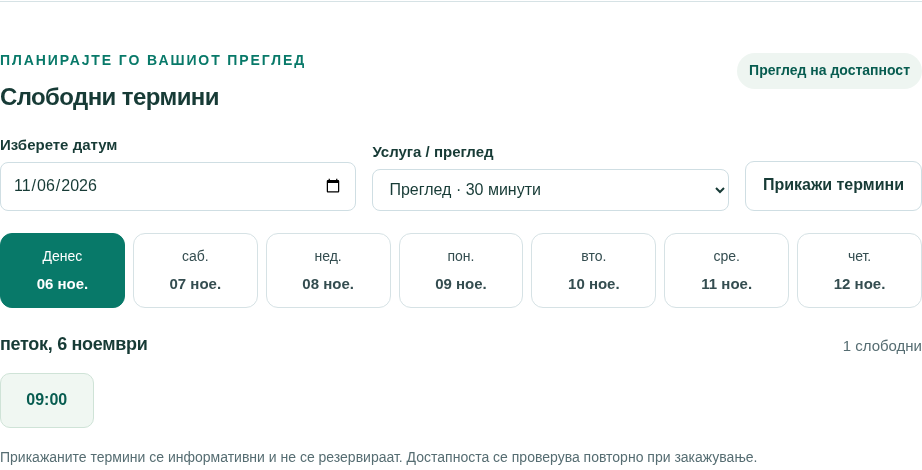

## 07 | Најава, регистрација и помош за пристап
Ако веќе имате сметка, изберете **Најави се**, внесете ги е-поштата за најава и лозинката и потврдете. Е-поштата ја идентификува сметката на клиниката. По успешна најава се отвора работниот простор или се продолжува текот за лекарот/терминот што сте го избрале.

Нов пациент може да избере **Создајте пациентска сметка**. Ако формуларот бара избор, одберете ја соодветната клиника, внесете име, е-пошта и лозинка и зачувајте. Јавната регистрација создава пациентски профил и пациентска сметка заедно. Не создава лекарска или рецепционерска сметка. Клиниката мора да дозволува регистрација на нови пациенти.

Ако рецепцијата веќе ви направила пациентски профил, побарајте да ви создаде/активира најава поврзана со тој профил. Јавната регистрација не поврзува автоматски нова сметка со постоечки профил само затоа што е-поштата изгледа исто. Избегнувајте дупли профили.

Лозинките треба да имаат **12–128 знаци**. Иконата со око го покажува само внесениот текст во тоа поле, а не зачуваната лозинка. При неуспешна најава, проверете го јазикот на тастатурата и случајни празни места. Повеќе неуспешни обиди може привремено да го заклучат пристапот. Нема обновување лозинка преку е-пошта: за клиничка сметка контактирајте ја рецепцијата, а за компаниска сметка — компаниската поддршка.

Сметките се врзани за клиника. Сметка од една клиника не отвора заштитен работен простор на друга. При преминување на друга адреса/поддомен може повторно да биде потребна најава; кога е можно, следете го истиот започнат тек на закажување.

## 08 | Почетниот екран „Преглед“
**Преглед** е почетното резиме на работниот простор. Тоа е практична почетна точка, а не целосен уредувач на сите записи.

Пациентот гледа претстојни прегледи, барања што чекаат потврда, пристап до лекари/услуги и претходни посети. Рецепцијата ја гледа денешната активност во клиниката, следните закажувања и барањата што бараат внимание. Кај лекарот резимето е насочено кон неговите термини и часови.

Кликнете на следен термин за детали. За нов преглед, користете го главното копче за закажување или **Пронајди лекар**. Неделниот приказ дава брза ориентација; за точен избор на датуми и филтри отворете **Календар** или **Термини**.

Броевите зависат од улогата, тековниот датум и тековните статуси. Бројка во резимето не е финансиски извештај и не значи автоматски дека прегледот е реализиран.

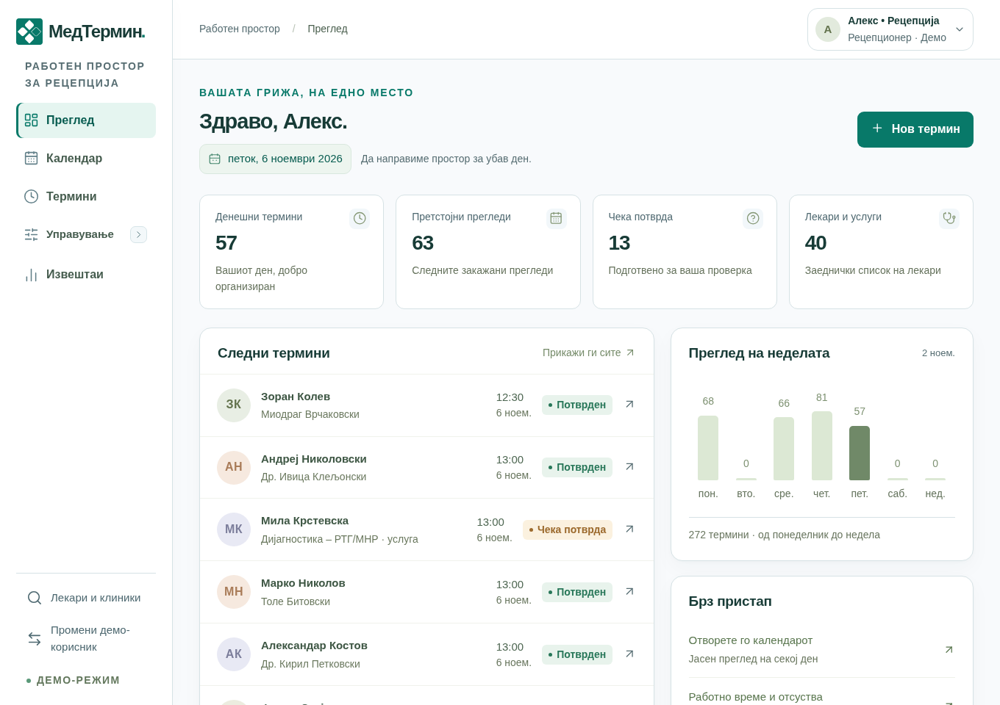

## 09 | Закажување: избор на податоци
Закажувањето се отвора преку **Пронајди термин** кај лекар, **Закажи** кај пациент, главното копче на Преглед или соодветно време во Календар. Прозорецот има три чекори: **Лекар и термин**, **Проверка** и резултат од зачувувањето.

1. **Лекар:** изберете лекар или услужен профил. Може да пишувате за пребарување во листата, па да изберете вистински резултат.
2. **Услуга / преглед:** изберете понудена услуга. Нејзиното траење одредува колку време ќе зафати терминот. Постари профили може да го користат основното траење без доделена услуга.
3. **Изберете датум:** внесете датум. Редовното закажување е за идни часови, до 180 дена однапред.
4. **Пациент:** вработениот избира пациент; најавениот пациент закажува за себе. Пребарајте и одберете го точниот запис. Ако лицето е навистина ново, вработениот може да користи **+ Додај пациент**.
5. Изберете слободен час. Проверете го траењето и пораката за рецепција/потврда.
6. Кликнете **Провери го терминот**.

> Внесено име не значи направен избор. Изберете резултат од листата пред да продолжите. Апликацијата го одбива непотврдениот текст наместо тивко да го задржи претходниот избор и да закаже за погрешно лице.

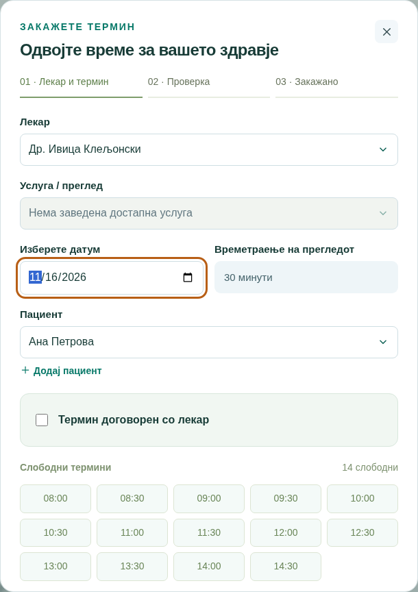

## 10 | Закажување: проверка, зачувување и резултат
Во чекорот за проверка се прикажуваат лекарот, пациентот, услугата, датумот, часот и траењето. Проверете ги сите податоци, особено ако има лица со слични имиња. **Назад** ве враќа на изборот за да направите корекција.

Последното копче го зачувува терминот. Почекајте го одговорот. Успешниот резултат покажува статус и број на резервација што почнува со **CL-**. Потоа може да отворите **Види термин** или да завршите со **Готово**.

Зачуваниот термин е веднаш потврден или резервиран со чекање потврда од персоналот. Тоа зависи од поставката на лекарот; термин договорен со лекар преку рецепција се потврдува веднаш. Термин што чека потврда веќе го зафаќа избраниот час.

Слободен час што сте го виделе претходно може во меѓувреме да биде зафатен. Ако друг корисник го резервира прв, системот ја одбива преклопената резервација и бара нов избор. Без успешен резултат не претпоставувајте дека терминот е зачуван. При прекин на врската за време на зачувување, освежете и проверете во **Термини** пред нов обид — првото барање можеби успеало.

Тековната верзија не испраќа е-пошта, SMS или автоматски потсетник. Соопштете ги деталите на пациентот или побарајте да ги провери во својата сметка.

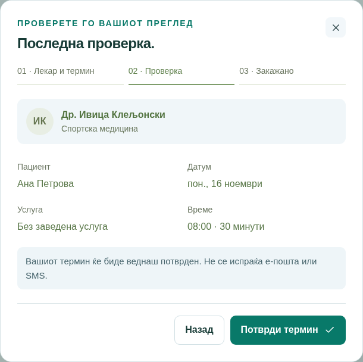

## 11 | Петте статуси на термин
| Статус | Значење и начин на доделување | Што следува |
| Чека потврда | Нов или презакажан термин кај лекар што бара потврда. Часот е резервиран. | Персоналот потврдува идно барање, или дозволено откажување го ослободува часот. |
| Потврден | Закажување без потреба од потврда, рачна потврда од персоналот или договорен термин преку рецепција. | Додека е иден може да се презакаже/откаже; по крајот се евидентира исход. |
| Завршен | Прегледот завршил и овластен вработен го означува како завршен. Во извештаите се користи и Реализирани. | Краен статус. Не се доделува автоматски со поминување на часот. |
| Откажан | Овластен корисник откажал соодветен термин и ја потврдил постапката. | Краен статус; часот повторно се ослободува ако другите правила го дозволуваат тоа. |
| Не се појавил | По крајот на терминот персоналот евидентира дека пациентот не дошол. | Краен статус. Не се доделува автоматски. |

Пациентите не можат да потврдуваат барања или да означуваат завршен преглед/недоаѓање. Можат да ги откажуваат своите дозволени идни термини. Рецепцијата работи низ клиниката, а лекарот — со сопствените термини.

Ако почетокот на термин што чека потврда веќе поминал, тој не може да се потврди или презакаже. Персоналот може да го откаже; по неговиот крај може наместо тоа да означи завршен преглед или недоаѓање. Потврден термин што веќе почнал се разрешува по крајот како завршен/недоаѓање, а не преку редовно откажување на иден термин.

Нема автоматски статус „истечен“, „пристигнат“ или „во тек“. Краен статус не се отвора повторно преку редовните копчиња. За погрешно евидентиран исход обратете се кај овластениот администратор.

## 12 | Листа на термини, детали, промени и историја
Во **Термини** изберете **Претстојни**, **Претходни** или **Сите**. „Претходни“ е групирање во приказот, а не шести статус. Таму може да има минати барања и откажани термини, покрај завршени прегледи.

Пребарувајте по име на лекар/пациент и комбинирајте ги достапните филтри за лекар, пациент, услуга, статус и датум. Пациентската и лекарската сметка имаат ограничен приказ. Почетниот и крајниот датум се вклучени во периодот. **Исчисти** ги трга ограничувањата.

**Детали** ги покажува учесниците, услугата, датумот/часот според клиниката, траењето, бројот на резервација, статусот и историјата. Во временската линија се гледаат зачувани создавања, презакажувања и промени на статус, со кој и кога ги направил. Постари термини може да се создадени пред воведувањето детална историја; непостоечките стари записи не се реконструираат.

За дозволен иден преглед изберете **Презакажи**. Се отвора првичниот датум, а лекарот, пациентот, услугата и траењето остануваат заклучени. Изберете нов слободен час, проверете и зачувајте. Ако лекарот бара потврда, презакажаниот термин повторно чека потврда. Неуспешно презакажување ја задржува старата резервација.

За откажување изберете **Откажи преглед** и прочитајте го дијалогот. **Задржи ја тековната состојба** ја прекинува постапката; копчето за потврда ја извршува. Откажаниот термин останува во историјата. Не се бришат пациентот или неговата сметка.

## 13 | Секојдневна работа на пациент
1. Најавете се во соодветната клиника и проверете **Преглед** за следната посета и евентуално чекање потврда.
2. Преку **Пронајди лекар** разгледајте лекари, услуги и распореди. **Види профил** дава информации, а **Пронајди термин** отвора закажување. За лекар што работи преку рецепција, контактирајте ја клиниката.
3. Закажете слободен час и прочитајте го резултатот. Чекање потврда сè уште не значи потврден преглед.
4. Во **Термини** следете ги идните закажувања, откажете/презакажете кога е дозволено и прегледајте ги претходните посети.
5. Во **Мој профил** проверете ги контактите, бројките и сопствената историја. Филтрите помагаат да пронајдете конкретна посета.
6. За корекција на контакт или проблем со пристап, побарајте помош од рецепцијата. Пациентот не го уредува сам клиничкиот контактен запис од овој екран.

Стандардните ограничувања за самостојно закажување се **три идни активни термини** и **едно барање што чека потврда кај ист лекар во ист ден**. Овие две поставки може да бидат поинаку конфигурирани. Идните термини внесени од персоналот се бројат во вкупниот број. За оправдан дополнителен преглед контактирајте ја рецепцијата; не правете нова сметка за да го заобиколите ограничувањето.

Не може да имате два преклопени прегледа, дури и кај различни лекари. Не може да гледате или закажувате за друг пациент преку вашата сметка. Имињата, услугите и контактите внесени од клиниката остануваат на оригиналниот јазик и кога интерфејсот е на англиски.

## 14 | Секојдневна работа на рецепција
Рецепцијата има преглед на целата клиника. Почнете со **Преглед**, па отворете **Календар** или **Термини** за денешната работа и нерешените барања.

За телефонско закажување најпрво пребарајте го постоечкиот пациент. Проверете ги името и контактите пред да направите нов профил. Одберете лекар/услуга, датум и час, проверете и зачувајте. Кажете му го конечниот статус на повикувачот — системот во моментов не ја испраќа пораката наместо вас.

**Управување → Пациенти** служи за контактни корекции и историја. **Управување → Лекари** служи за профили, закажување и работно време. Само администратор на клиниката ги уредува специјалностите, услугите и сметките за најава.

Проверувајте ги барањата за потврда пред нивниот почеток. По завршување на прегледите евидентирајте завршен преглед или недоаѓање. Изминатите непотврдени барања разрешувајте ги изречно. Ако треба да затворите часови што имаат закажан пациент, прво договорете презакажување/откажување.

Рецепцијата може да внесе оправдан термин над пациентското ограничување, но не може да направи преклопување кај лекар или пациент, ниту да заобиколи блокирано отсуство. За конкретен час одобрен од лекар надвор од редовниот распоред, користете ја постапката во поглавје 20.

При предавање смена пренесете ги нерешените барања, телефонските договори и одбиените промени. Работете со лични сметки за историјата да покажува кој ја направил постапката. На крај одјавете се преку прозорецот горе десно.

## 15 | Секојдневна работа на лекар
Лекарската сметка мора да биде поврзана со постоечкиот профил на тој лекар. Таа не е општа администраторска сметка на клиниката.

Преку **Преглед**, **Календар** и **Термини** следете ги сопствените закажувања. Отворете посета за пациентските податоци, потврда, историја и достапни исходи. Потврдете идно барање кога е соодветно; по крајот означете **Завршен** или **Не се појавил**.

Во **Управување → Лекари**, преку менито со три точки отворете ја сопствената **Достапност**. Уредувајте неделни часови, паузи, отсуства и дополнителна достапност. Промена што би нарушила веќе закажан преглед се одбива. Не може да го менувате распоредот на друг лекар.

Во **Пациенти** може да најдете клинички контакти, да додадете профил или да коригирате контактни податоци. Во историјата на пациент гледате прегледи кај вас, а не целата историја кај други лекари. Ова е контактен/организациски профил, а не електронско медицинско досие.

Може да закажувате редовни термини за својата работа во понудената достапност. Посебната опција **Термин договорен со лекар** е за рецепција/администратор. Побарајте рецепцијата да ја употреби за однапред одобрен еднократен час.

Улогата Лекар не дава пристап до клиничките Извештаи, Сметки и пристап, уредување специјалности/услуги или распоред на други лекари.

## 16 | Календар за персоналот
**Календар** е достапен за лекари и рецепција. Рецепцијата може да филтрира по лекар, специјалност, услуга и статус; лекарот го гледа својот распоред. Изберете конкретен лекар за слободната достапност и отсуствата да се прикажат покрај закажувањата.

Користете **Ден**, **Недела**, **Месец** или **Период**. Прилагодениот Период дозволува 1–31 ден. Претходно/следно го менува прикажаниот период; **Денес** враќа кон тековниот ден. Неделата почнува во понеделник. На телефон дневниот приказ обично е попрегледен; пошироките прикази може да се лизгаат внатре во календарот.

Кликнете на закажан запис за детали. Соодветен слободен дел или **Нов термин** отвора закажување. Зелената достапност е помошен приказ, а не зачувана резервација. Конечните правила повторно се проверуваат.

На поддржани компјутерски уреди може да повлечете дозволен иден термин кон нов час. Прочитајте ја потврдата. При преклопување или неуспех, записот се враќа на старата позиција. Повлекувањето не го менува траењето.

**Освежи** ги ажурира податоците. Легендата ги објаснува боите; читајте го и текстот на статусот. Проширете **Работно време и информации за избраниот лекар** за распоредот и пристапот до управување со достапност.

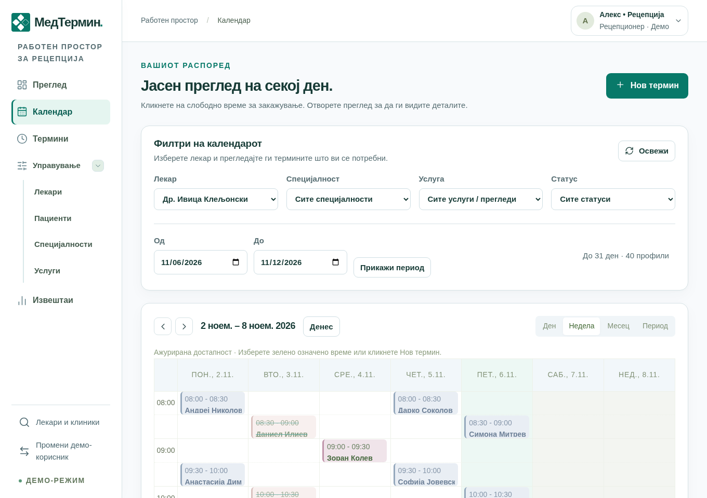

## 17 | Лекари: картички, листа и поставки
Отворете **Управување → Лекари**. Пребарувајте по име или специјалност, користете филтер за специјалност и изберете **Листа** или **Картички**. Избраниот приказ се памети во тој прелистувач.

**Види профил** покажува специјалност, начин на закажување, услуги и неделно работно време. **Пронајди термин** започнува закажување; каде што пациентот мора да контактира рецепција, има информативна постапка. Ознаката покажува утврдено време, работа по договор или неактивност.

За персоналот, **менито со три точки** содржи **Достапност** и, за рецепција/администратор, **Измени**. Лекарот ја користи достапноста за сопствениот профил. Овие постапки се одвоени од двете главни копчиња за профил и закажување.

Рецепцијата додава/уредува име на лекар, специјалност, незадолжителна субспецијалност, активност, потреба од потврда и закажување само преку рецепција. **Потребна е потврда за закажување** одредува дали редовен нов/презакажан термин чека одобрение. „Преку рецепција“ одредува кој може да закаже, а не дали терминот автоматски е потврден.

На нов лекар му требаат часови и доделени услуги за корисно онлајн закажување. Неактивноста спречува нови закажувања, но не брише стари термини или сметка за најава. Увезени услужни профили може да се прикажуваат меѓу понудувачите, но не се поврзуваат со човечка лекарска сметка.

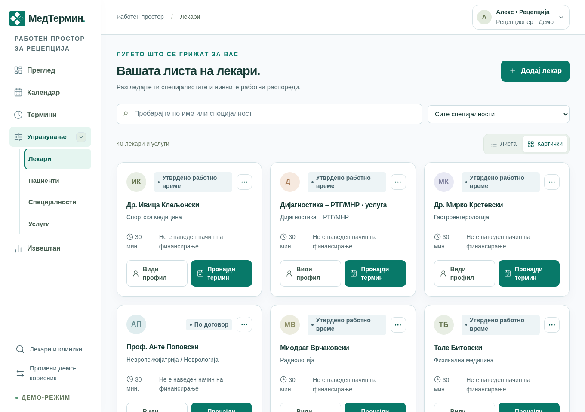

## 18 | Неделно работно време
Отворете **Достапност** кај лекарот преку трите точки или од календарот. Неделното работно време го дефинира редовниот распоред што се повторува.

Со **Додај работен период** внесете ја секоја смена. Изберете ден, почеток и крај. Поделена смена има одделни редови, на пример понеделник 09:00–12:00 и 14:00–17:00. Ред се отстранува со неговото копче, а **Зачувај работно време** го зачувува целиот прикажан распоред.

Полето за траење дозволува 10–120 минути, со чекор од пет минути. Активните услуги може да имаат сопствено траење според кое се создаваат термините. Постоечки закажувања го задржуваат зачуваното траење. Почетокот мора да е пред крајот, во периодот мора да собира цел преглед, а периодите во ист ден не смеат да се преклопуваат.

Слободните часови се пресметуваат од зачуваниот распоред, без веќе закажаните термини и блокираните отсуства. Додавање лекар или преместување редови не создава измислени часови. Деновите се прикажуваат по ред од понеделник до недела; забелешки од увезен документ не му наредуваат на системот прво да пополнува еден ден, па друг.

Ако колега го сменил распоредот додека уредувате, зачувувањето се одбива со порака за конфликт. Зачувајте си ги потребните белешки, вчитајте го тековното време преку понудената постапка, споредете и повторно внесете ја намерата. Не испраќајте го стариот формулар бесконечно.

## 19 | Исклучоци, отсуства и дополнителни часови
Неделните часови се повторуваат. **Исклучоци и отсуства** важат за конкретен датум: празник, пауза, отсуство или еднократен дополнителен период.

1. Изберете **Датум**.
2. Одберете **Недостапно / пауза** за блокирање, или **Дополнителна достапност** за дополнителни слободни часови.
3. Внесете **Од**, **До** и кратка **Причина**, на пример „Пауза за ручек“. Не внесувајте медицински информации во ова поле.
4. Кликнете **Додај исклучок** и почекајте потврда.
5. Проверете во **Зачувани исклучоци**. Копчето за отстранување го брише тој исклучок, со потврда кога е прикажана.

За целодневно блокирање формуларот советува 00:00–23:59. Новите закажувања обично се во прозорец од 180 дена. Пауза спречува закажување и во редовни работни часови. Дополнителна достапност може да отвори часови во ден што инаку не е работен.

Повеќекратно кликање не е наменето за создавање исти дупли исклучоци; идентичен зачуван запис се одбива. Се одбива и промена што би нарушила постоечки иден преглед. Прво договорете презакажување/откажување со пациентот. Отстранување дополнителен период не смее да остави закажан преглед без потребната достапност.

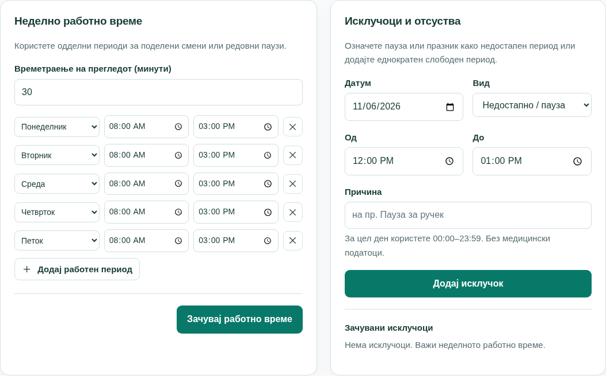

## 20 | Термин договорен директно со лекар
Ова е случајот кога лекарот нема редовен распоред, но рецепцијата веќе разговарала со него и тој одобрил конкретен час.

Рецепцијата/администраторот отвора редовно закажување, избира лекар, услуга, датум и пациент и ја вклучува опцијата **Термин договорен со лекар**. Се внесува одобрениот **Договорено време**, се проверува и се зачувува.

Системот ја запишува еднократната достапност потребна за тој преглед заедно со резервацијата. Не го менува неделното време и не отвора цел дополнителен ден за сите пациенти. Терминот е веднаш **Потврден**, бидејќи часот веќе е договорен.

Опцијата не дозволува игнорирање на постоечки термин кај лекарот, друг преклопен преглед на пациентот или блокирано отсуство. Заштитите остануваат. Часот мора да е во иднина и во дозволениот период, да почнува во цела минута и да завршува истиот ден. Кога има доделени услуги, потребна е и соодветна услуга/траење.

Пациентска или лекарска сметка не ја користи оваа рецепционерска постапка. Прво добијте согласност од лекарот — означувањето на полето не воспоставува повик и не обезбедува одобрение наместо вас.

Со откажување се отстранува и еднократната достапност прикачена за тој термин. При преместување во друг час преку редовно презакажување, новиот час мора да има важечка достапност и повторно се проверува правилото за потврда.

## 21 | Пациенти и контактни профили
**Управување → Пациенти** е контактниот преглед на клиниката. Пребарувајте по име, е-пошта или телефон. Користете **Листа** или **Картички**, **Види профил** за детали и **Закажи** за избраното лице.

**Додај пациент** создава контактен профил, а не податоци за најава. Внесете име; е-пошта и телефон може да останат празни каде што е дозволено. Пребарајте прво и користете посебен запис за секое лице. Иста непразна контактна е-пошта не може да се употреби за друг пациент во истата клиника.

Во профилот, персоналот преку **Уреди податоци** ги коригира името, контактната е-пошта и телефонот. Со тоа не се менуваат е-поштата за најава, лозинката или прикажаното име на сметката. Пациентот бара корекција од персоналот. Ако друг вработен веќе го сменил записот, вчитајте ја тековната верзија пред ново зачувување.

Профилот содржи број на претстојни, завршени, откажани и нереализирани прегледи поради недоаѓање, како и табела со историја. Филтрирајте по период, статус, лекар, услуга или датуми, тргнете ги филтрите и отворајте детали. Рецепцијата ја гледа историјата во клиниката; лекарот — посетите кај него; пациентот — сопствената дозволена историја.

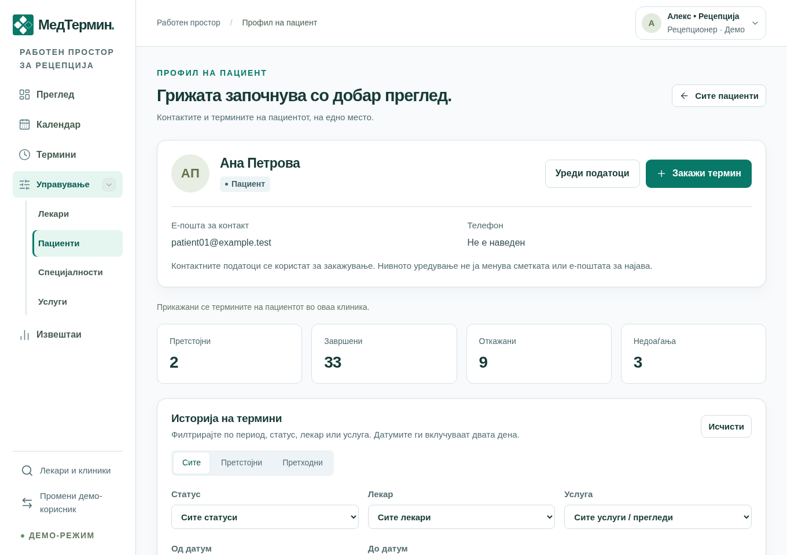

## 22 | Специјалности и услуги
Овие делови во **Управување** ги уредува само рецепција/администратор на клиника. Се прикажуваат како едноставна листа, без избор на картички.

**Специјалности** ги организира понудувачите по област, на пример кардиологија. Пребарајте, отворете **Додај запис**, внесете назив и зачувајте. **Измени** уредува постоечка специјалност. Преименување поврзана специјалност го ажурира описот кај нејзините лекари. Дупли називи се одбиваат.

**Услуги** кажува што може да се закаже. Внесете/уредете име, специјалност, траење, активност и лекари/профили што ја извршуваат. Траењето е 10–120 минути, во чекори од пет минути. Еден лекар може да има повеќе услуги, а една услуга — повеќе соодветни понудувачи.

Услуга се нуди за ново закажување само ако е активна и доделена на избраниот понудувач. Недоделена или неактивна услуга, или неактивен лекар, може да објасни празен избор или недостиг на термини. Потребно е и работно време; самата услуга не создава распоред.

Повлекување услуга од активна понуда не ги брише старите детали. Новото траење важи за нови закажувања, додека постоечкиот термин го задржува своето. Услужните увезени профили се ресурси за закажување, а не лица што треба да добијат лекарска најава.

Практичен редослед: специјалност → лекар/профил → создавање и доделување услуги → работно време → сметки за персонал → проверка на достапност.

## 23 | Создавање сметки за пациенти и персонал
Отворете **Сметки и пристап** како администратор на клиника. Насловот на екранот е **Корисници и пристап**. Ова дава дозвола за најава и е одделно од додавање пациентски или лекарски профил.

| Улога | Потребен поврзан профил | Вообичаена употреба |
| Пациент | Постоечки пациентски профил. | Онлајн пристап до сопствените термини за пациент закажан по телефон. |
| Лекар | Постоечки профил на вистински лекар. | Лекарот го управува својот распоред и исходите. |
| Администратор | Без пациентски или лекарски профил. | Пристап за друг овластен рецепционер. |

Внесете **Прикажано име**, **Е-пошта за најава**, улога и почетна лозинка. Се прикажува само соодветниот избор за профил. Изберете го точното неповрзано лице и **Создај сметка**. Лозинката треба да има 12–128 знаци.

Еден пациентски/лекарски профил има една поврзана сметка. Профили што веќе имаат сметка се изоставени, дури и ако сметката е оневозможена. Услужни профили не се нудат за лекарска најава. Е-пошта веќе резервирана за друга клиничка сметка не може повторно да се користи.

Не се испраќа покана преку е-пошта. Предадете ги податоците приватно на вистинското лице и побарајте промена на почетната лозинка. Ако лицето веќе се регистрирало самостојно, проверете ги постоечките сметки пред да правите нов профил или најава.

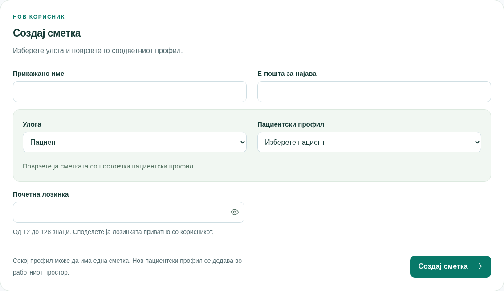

## 24 | Постоечки сметки, лозинки и пристап
Во **Постоечки сметки** се прикажуваат име, е-пошта, улога и дали пристапот е овозможен. Оневозможување сметка не е исто што и откажување термини или бришење пациентски/лекарски профил.

**Оневозможи пристап** ја блокира најавата и ги одјавува постоечките сесии. **Овозможи пристап** повторно дозволува најава, но старите сесии не се враќаат автоматски. Не може да ја оневозможите сопствената сметка или да ја оставите клиниката без активен администратор.

Проширете **Постави податоци за најава** за да поставите е-пошта за најава и нова лозинка, па зачувајте. Ова служи и за помош на пациент што заборавил лозинка. Со зачувувањето се одјавуваат сите сесии на таа сметка и се отстранува заклучувањето по погрешни лозинки. Нема автоматска е-пошта; предадете ги новите податоци безбедно.

Менување контактна е-пошта во Пациенти не ја извршува оваа постапка. Менување најавни податоци не го препишува контактниот профил. Постоечките сметки немаат општ екран за префрлување улога/поврзан профил; погрешно поврзување решавајте го со овластениот администратор, без менување туѓи пациентски податоци.

Не споделувајте рецепционерска лозинка со лекар или пациент. Изберете соодветна улога, одделни лични сметки за персоналот и точниот пациентски профил. Иконата со око прикажува само нововнесен текст, не зачувана лозинка.

## 25 | Извештаи, графикони и CSV
**Извештаи** се достапни за администратори на клиниката. Изберете почетен/краен датум, по потреба лекар, специјалност или услуга и **Прикажи извештај**. Брзите избори се денес, оваа недела и овој месец. Податоците по време може да се групираат по ден, недела или месец; неделите почнуваат во понеделник. Максималниот период е 366 дена.

Картичките прикажуваат вкупно термини, потврдени, реализирани, непотврдени, откажани, недоаѓања, различни пациенти и приближна искористеност. Вкупниот број ги вклучува и откажаните. Се гледа локалниот датум на почеток на терминот и неговиот тековен статус, а не датумот кога е притиснато копчето за статус.

Процентот на откажување е откажани / сите термини. Процентот на недоаѓање е недоаѓања / (реализирани + недоаѓања). Цртичка значи дека нема соодветна основа за пресметка. „Пациенти во периодот“ брои различни лица во избраните термини, вклучувајќи откажани; вкупно регистрираните пациенти се посебна бројка за клиниката.

Графиконот ја прикажува активноста низ периодот. Табелите се групираат по период, лекар/профил, специјалност или услуга. **Преземи CSV** ја презема тековно избраната табела со информации за филтрите, за отворање во табеларна програма.

Искористеноста ги споредува зафатените неоткажани минути со капацитетот од тековните часови и зачуваните исклучоци. Не е историски запис за персоналот. Капацитетот е споделен меѓу услуги и не треба да се собира за секоја услуга одделно. Извештаите покажуваат организациска активност, а не наплата или медицински квалитет.

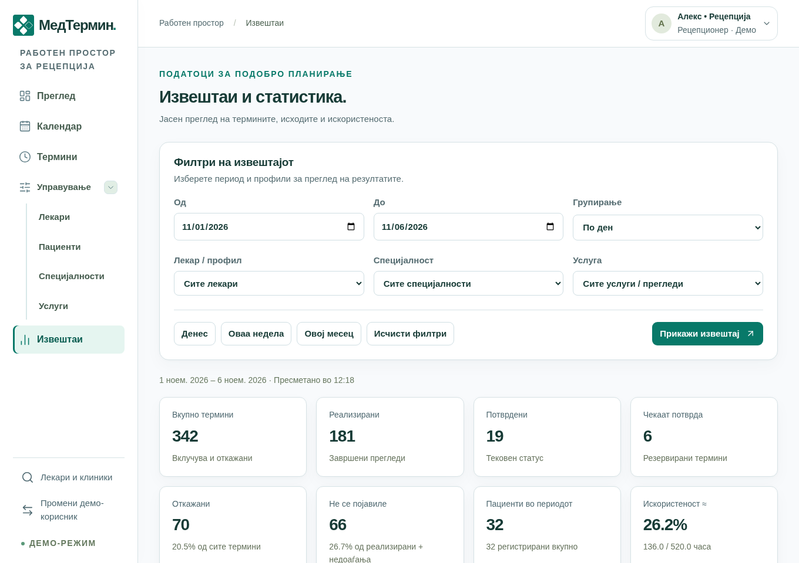

## 26 | Компаниска администрација: нова клиника
Компанискиот администратор се најавува преку компанискиот портал, вообичаено **admin.medtermin.mk**. Клиничката сметка не дава пристап тука. Во јавното подножје намерно нема врска за компаниска администрација.

**Регистрирани клиники** ги прикажува регистрациите и подготвеноста. **Додај нова клиника** создава клиника и нејзин прв клинички администратор.

| Поле | Што се внесува |
| Единствен идентификатор | Единствен краток ID: 1–40 мали латинични букви, броеви или цртички; првиот знак е буква/број. Потоа не се менува. |
| Име на клиниката | Јавно име, од 2 до 100 знаци. |
| Јавен опис / адреса / телефон | Незадолжителни јавни податоци: опис до 1.000 знаци, адреса до 200, телефон до 30. За мапа внесете улица, број, град и држава. |
| Јавно пребарување | Дали клиниката се прикажува за јавни посетители. |
| Пациентска регистрација | Дали нови пациенти смеат самостојно да се регистрираат. |
| Почетен администратор | Име, е-пошта за најава и приватна почетна лозинка од 12–128 знаци. Ова е клиничка, а не компаниска сметка. |

Притиснете **Создај клиника и администратор** еднаш и почекајте. Подготовка значи дека постапката трае; неуспешна состојба/потребно повторување бара проверка, а не случајни повторени внесови. Кога е подготвена, предадете ги најавните податоци безбедно. Не се испраќа покана преку е-пошта.

Новата клиника нема пополнет распоред. Нејзиниот администратор треба да внесе специјалности, лекари, услуги и работно време и да создаде други сметки. Клиниките имаат одделни пациентски/термински податоци, иако користат ист производ.

## 27 | Компаниска администрација: уредување клиника
Кај подготвена управувана клиника изберете **Измени податоци**. Уредете јавен назив, опис, адреса, телефон и опциите за јавен приказ и нови регистрации, па **Зачувај податоци**.

Овие две опции имаат различни цели. Сокривање од јавното пребарување не ги брише податоците и не ги одјавува автоматски корисниците. Забрана на нова регистрација спречува нови самостојни пријавувања; постоечките сметки и термини остануваат.

Идентификаторот е фиксен. Временската зона не се менува како редовен податок, бидејќи постоечките закажувања зависат од запишаното време. За планирана промена вклучете ја поддршката.

Постара клиника може да има ознака **Конфигурација** и **Управувај преку платформата**. Тоа е еднократно пренесување во редовно компаниско управување. Ги задржува постоечките пациенти, сметки и термини; не регистрирајте дупликат само за да ја смените адресата. Потоа јавните детали се уредуваат од овој екран.

Ако друг компаниски корисник ги сменил податоците пред вас, зачувувањето се одбива. Постапката за отфрлање/повторно вчитување ги зема неговите најнови вредности; не ги спојува автоматски со вашиот незачуван текст.

Компаниската страница има сопствена одјава и промена на компаниска лозинка. Промената ги одјавува активните сесии. Ова е одделно од управувањето со клинички лозинки.

## 28 | Лични поставки, јазик, изглед и телефон
Во работниот простор кликнете на **вашето име/аватар горе десно**. Се отвора прозорец со корисникот, улогата, клиниката кога е достапна и следните опции:

- **Изглед:** Standard, Dark или Vibrant. Боите се менуваат веднаш и изборот се памети за тој прелистувач/адреса. Не се менуваат клинички податоци или формуларот зад прозорецот.
- **Јазик:** знаменцата MK и EN менуваат македонски/англиски. Македонскиот е првичен јазик. Се вчитува страницата повторно со задржување на местото; предупредување ги штити незачуваните внесови. Имиња и записи внесени од клиниката не се преведуваат.
- **Временска зона:** информација како се прикажува клиничкото време, вообичаено Europe/Skopje. Ова не е поставка со која пациентот го менува часот на терминот.
- **Промени лозинка:** внесете тековна/нова лозинка; зачувувањето ги одјавува активните сесии. Достапно е за редовни сметки, а не за демо-пристап без лозинка.
- **Одјави се:** завршува пристап од овој прелистувач. Користете го на заеднички уред.

Затворете со X, Escape или клик надвор. Tab останува во отворениот прозорец. На мал телефон лизгајте внатре кога е потребно. Се почитува изборот за намалено движење и прозорецот се крие при печатење. На јавни, најавни и компаниски страници, изборите за јазик/изглед остануваат при дното.

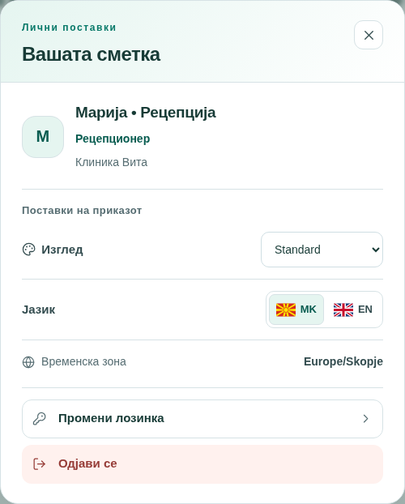

## 29 | Кога повеќе луѓе работат истовремено
Повеќе рецепционери можат да работат во истата клиника. Системот повторно проверува при зачувување, бидејќи некој може да сменил термин или распоред откако сте го отвориле формуларот.

| Ситуација | Што се случува | Што да направите |
| Двајца избираат ист лекар/час | Може да се зачува само дозволено закажување без преклопување. | Прочитајте ја пораката, освежете и изберете друг час. |
| Пациентот има преглед кај друг лекар | Преклопеното закажување се одбива. | Најдете час што одговара и на пациентот и на лекарот. |
| Колега претходно сменил распоред, контакт или термин | Стариот внес се одбива наместо тивко да ја препише новата промена. | Вчитајте ги актуелните податоци, споредете и повторно внесете ја намерата. |
| Барањето прекинало поради врска | Можеби било зачувано пред да се изгуби одговорот. | Проверете листа/историја пред ново закажување. |

Податоците се освежуваат во заднина, но тоа не е дозвола за препишување стар формулар. Отворените дијалози го паузираат редовното освежување. Нацрт-распоредот го задржува првичниот контекст додека не зачувате или изречно не вчитате нови податоци.

Повторување на истото барање за закажување има заштита од дуплирање, но не ја заменува проверката на резултатот. Не кликајте повеќепати. Неуспешно презакажување го задржува стариот термин; откажување бара потврда. Овие правила го штитат распоредот, но не гарантираат дека посакуваниот час ќе остане слободен засекогаш.

## 30 | Четири примери од секојдневната работа
**А. Посетител пронаоѓа лекар.** Пребарува „кардиологија“, отвора профил, избира услуга/ден и кликнува час. Се најавува или создава дозволена нова пациентска сметка, ги проверува пренесените податоци и зачувува. Потоа чита дали терминот е потврден или чека потврда. Јавниот приказ на часот сам по себе не бил резервација.

**Б. Пациент се јавува по телефон.** Рецепцијата го пребарува пациентот, ги проверува лицето и контактот, отвора **Закажи**, избира лекар/услуга и зачувува слободен час. Ако пациентот сака онлајн пристап, се создава сметка Пациент поврзана со истиот профил и приватно се предаваат најавните податоци. Не треба втор пациентски профил.

**В. Лекар одобрил 14:00 во ден без редовни часови.** Рецепцијата ја проверува согласноста, избира **Термин договорен со лекар**, внесува час и зачувува. Тоа успева само без преклопување или блокирано отсуство. Неделниот распоред не се менува, а терминот е потврден. Системот не воспоставува контакт со лекарот самостојно.

**Г. Лекар мора непланирано да отсуствува.** Персоналот прво ги проверува идните закажувања и ги контактира пациентите за дозволено презакажување/откажување. Потоа овластениот корисник додава отсуство за датумот. Ако сè уште постои заштитен преклопен термин, отсуството се одбива. Внесот не ги известува или преместува пациентите автоматски.

> Вежбајте со демонстративни податоци. Не менувајте вистински термини само за да испробате копчиња.

## 31 | Чести прашања и пораки
| Прашање или порака | Што да проверите |
| Нема соодветен лекар/пациент | Скратете го пребарувањето, проверете кирилица, отстранете филтри и проверете ја клиниката. |
| Нема слободни термини | Друг датум/услуга; причина може да се часови, отсуство, закажувања или работа преку рецепција. |
| Внесено е име, но не продолжува | Изберете вистински резултат од листата. |
| Нема профил за нова сметка | Можеби веќе е поврзан. За лекарска најава е потребно лице, а не услужен ресурс. |
| Не успева јавна регистрација | Можеби е забранета, е-поштата е зафатена или веќе има профил. Прашајте рецепција. |
| Заборавена лозинка / недостапна сметка | Проверете го внесот со окото; побарајте овластена помош за лозинка/пристап. Нема обновување преку е-пошта. |
| Не може Завршен / Не се појавил | Почекајте да заврши терминот и користете овластена сметка. |
| Изминат термин што чека потврда | Персоналот го разрешува изречно; пациентот контактира рецепција. Нема автоматско истекување. |
| Променето во друга сесија/прозорец | Вчитајте ја тековната верзија, не го повторувајте стариот внес. |
| Мапа/надворешна врска не се вчитува | Проверете адреса и врска; отворете Maps или јавете се во клиниката. |
| Истечена сесија / немате пристап | Најавете се со точната улога/клиника. Не користете туѓа сметка за заобиколување. |
| Сервисот е привремено недостапен | Проверете/освежете кога е соодветно и контактирајте поддршка. Не претпоставувајте дека внесот сигурно успеал или сигурно пропаднал. |

## 32 | Поими, ограничувања и практична проверка
| Поим | Значење |
| Клиника | Организацијата со чии корисници, пациенти и распоред работите. |
| Пациентски профил | Контактен запис и поврзана историја; може да постои без најава. |
| Сметка | Е-пошта, лозинка и дозволи за најава. |
| Лекар/профил | Понудувач во распоредот; некои увезени профили претставуваат услуга, а не лице. |
| Специјалност / услуга | Специјалност е областа; услуга е понудениот преглед со определено траење. |
| Исклучок на достапност | Промена за конкретен датум, блокирана или дополнително слободна. |
| Број на резервација | CL-ознака за препознавање термин; не е лозинка или потврда за плаќање. |
| CSV | Преземената извештајна табела, погодна за табеларна програма. |

**Практични ограничувања:** редовно идно закажување до 180 дена; прилагоден календарски период 1–31 ден; извештај до 366 дена; траење 10–120 минути со чекор од пет; лозинки 12–128 знаци. Стандардно пациентот има до три идни активни термини и едно непотврдено барање кај ист лекар во ист ден; овие две граници може да се конфигурираат.

**Што не обезбедува тековниот производ:** автоматски е-пошта/SMS потврди и потсетници, обновување лозинка преку е-пошта, автоматско завршување/недоаѓање/истекување, онлајн наплата, дијагнози и записи за терапија, прикачување документи или една универзална пациентска сметка за сите клиники. Закажувањето само по себе не потврдува нечиј идентитет, а контактниот профил не е медицински картон.

**Пред прв работен ден:** проверете клиника/улога, поставете приватна лозинка, разгледајте вистински услуги/часови, вежбајте проверка на резервација и потврда на откажување и дознајте кому да се обратите за проблем. При предавање смена проверете непотврдени барања и неевидентирани исходи; на крај одјавете се.

За нова клиника: регистрација со администратор → специјалности, лекари и услуги → работно време → потребни сметки → проверка на јавни податоци и закажување → редовна работа.
